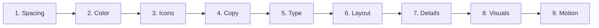

# Unslop UI Design Skill (Anti-Slop Design Engineering)

This skill provides an authoritative, systematic methodology to eradicate generic "AI slop" from frontend web interfaces. Grounded in Damir Sokolovsky's (`heydamir/unslop`) 9-pass design engineering pipeline and tailored for high-end web applications and gallery-grade art/geospatial projects like SEISMOLIVE v4.0.

---

## 1. The 10 AI Slop Anti-Patterns (Forbidden Tropes)

When AI tools (v0, Bolt, Lovable, Claude Artifacts) generate UI, they collapse into predictable, formulaic templates. This skill strictly prohibits the following:

| # | Forbidden AI Slop Trope | Why It Fails | Unslop Correction |
|---|---|---|---|
| 1 | **"Cards Everywhere" Syndrome** | Wrapping every single stat, quote, item, and metric into an identical rounded box (`rounded-xl` with border and backdrop blur). | Default to **no cards**. Use whitespace scale, column rhythm, and subtle hairlines (`border-b border-white/5`) instead of nested boxes. |
| 2 | **The Colored Left-Border Stripe** | Placing a 3~4px solid or gradient vertical stripe (`border-l-4 border-indigo-500` or `#C89D54`) on cards and blockquotes. | **Kill the left stripe**. Let typography (font size, weight, italic serif, and negative space) define quotations and callouts. Reserve colored bars strictly for urgent system alerts. |
| 3 | **Badge / Pill Overload** | Slapping all-caps pill badges (`px-2 py-0.5 rounded-full`) above every title, next to every metric, and inside every card. | Treat data as content, not status chips. Use quiet typographic metadata (e.g. `font-mono text-xs text-slate-400`) and subtle status dots. |
| 4 | **Emoji Icon Clutter** | Using emojis (`✦`, `✨`, `ℹ`, `🔇`, `🚀`, `🔥`) as decorative UI icons or bullet points. | Remove emojis completely from UI chrome. Use SVG hairline icons or omit icons where text alone is clearer. |
| 5 | **Box-in-a-Box (Nested Grid Hell)** | Nesting boxes 4-5 layers deep: container inside drawer inside grid inside card inside cell. | Flatten the DOM. Use a unified surface with hairline dividers or continuous background planes. |
| 6 | **Default Inter / System Font Monotony** | Using generic sans-serif with no typographic voice, paired with random italicized words in titles. | Distinctive, intentional type pairings (e.g. a high-contrast serif like *Noto Serif KR / Batang* paired with a geometric or grotesque monospace *SF Mono / Menlo*). |
| 7 | **Harsh Glowing Border Hovers** | Adding bright cyan/indigo border glows (`box-shadow: 0 0 15px rgba(...)`) on hover for every list item. | Restrained, tactile feedback: subtle background shift (e.g. `bg-white/[0.03]`), whisper hairlines, or micro-luminance elevation. |
| 8 | **Generic Centered Hero + 3-Card Grid** | Defaulting to the standard SaaS landing page layout regardless of domain context. | Bespoke structural layout: asymmetric split panes, ledger-style rows, spatial data catalogs, or continuous vertical narratives. |
| 9 | **Low-Contrast Washed-out Text** | Using low-contrast grays on dark backgrounds that make archival text unreadable. | Crisp, luminous typography: warm white (`#EAE4D5` / `#f1f5f9`) for primary content, pale muted slate (`#94a3b8`) for secondary, never illegible dim grays. |
| 10 | **Decorative "Vibe" Motion** | Adding distracting bouncing, spinning, or unnecessary fade-ins that slow down utility. | Functional spatial transitions only (fade/slide that explains origin and maintains orientation, duration 150~220ms). |

---

## 2. The 9-Pass Surgical Unslop Pipeline

When reviewing or redesigning any interface component, execute changes in this strict sequential order:

### Pass 1: Spacing (Rhythm & Negative Space)
- Audit padding and margins. Replace arbitrary spacing (`padding: 10px 14px`, `gap: 3px`) with a strict 4px/8px modular scale.
- Give primary titles and archival quotations generous breathing room (at least 20~28px of vertical clearance).
- Eliminate claustrophobic compact stacking. Let negative space carry the structure.

### Pass 2: Color (Palette Restraint)
- Restrict UI chrome to a disciplined palette:
  - Deep Ground Void: `#030712` ~ `#070c14`
  - Subtle Surface Elevation: `#0c1420` ~ `#101c2c` (with 80~90% opacity)
  - Hairline Separators: `rgba(255, 255, 255, 0.07)` or `rgba(142, 197, 252, 0.12)`
  - Primary Typography: Bone White (`#EAE4D5` / `#f8fafc`)
  - Accent / Heritage: Subdued Amber/Gold (`#C89D54` / `#d4a359`)
  - Science / Waveform: Atmospheric Ice Cyan (`#8ec5fc` / `#38bdf8`)
- Remove all saturated purple/violet gradients and gratuitous neon drop-shadows.

### Pass 3: Icons (Sanitization)
- Strip all emoji icons (`✦`, `ℹ`, `✨`, `🔇`, `🚀`) from functional buttons and section headers.
- Use crisp geometric SVG icons (14~16px, 1.25px stroke) or clean text labels without icons.

### Pass 4: Copy (Authentic Editorial Tone)
- Eliminate boastful, shouty, or dramatic AI placeholder language.
- Use precise, scholarly, and contemplative terminology (e.g. `사료 원문 및 감진역 복원` instead of `✦ 연속 지진 시퀀스 (전진 · 본진 · 여진 기록 연결)`).

### Pass 5: Type (Hierarchical Discipline)
- **Primary Headers**: Elegant, high-contrast serif (`"Noto Serif KR", "Nanum Myeongjo", Batang, serif`) with subtle letter-spacing (`0.02em ~ 0.04em`).
- **Telemetry / Metrics**: Tabular monospace (`"SF Mono", Menlo, Consolas, monospace`) with uppercase tracking (`0.05em`).
- **Body & Prose**: High-legibility serif or grotesque with comfortable line-height (`1.6 ~ 1.75`).
- Never italicize arbitrary header words.

### Pass 6: Layout (De-Boxing & Structural Flow)
- **Transform Card Grids into Archival Ledgers**: Replace stacked boxed cards with continuous ledger rows separated by hairline borders.
- **Flatten Nested Containers**: Remove outer card borders inside already bordered containers.
- Align columns cleanly (e.g. Era/Date column, Region/Title column, Verbatim Snippet, Epicenter Coordinates).

### Pass 7: Details (Hairlines & Subtle Depth)
- Replace thick borders and left-stripes with 1px hairlines: `1px solid rgba(255, 255, 255, 0.07)`.
- Use soft inner shadows or gentle ambient cushions instead of harsh multi-layered drop shadows.
- Keep interactive states subtle: a quiet `background: rgba(255, 255, 255, 0.035)` on hover rather than aggressive color jumps.

### Pass 8: Visuals (Authentic Materiality)
- Display authentic historical quotations in their true archival form.
- Scientific SVG diagrams (e.g. T-X Travel-Time curves) must have sharp, high-precision vector lines and clear axis legends without cartoon decorations.

### Pass 9: Motion (Purposeful & Restrained)
- Transitions must be instant or near-instant (150ms ~ 200ms `cubic-bezier(0.16, 1, 0.3, 1)`).
- Never use bouncing or elastic easing. The motion should feel like turn-of-page gallery transitions.

---

## 3. SEISMOLIVE Gallery-Grade UI Reference

When unsloping SEISMOLIVE v4.0's historical archive UI:
- **Archive Catalog (사료 목록)**: Should feel like a museum archival inventory index — a quiet, dark ledger where each row presents the imperial reign, date, seismic phenomenon, and verbatim chronicle quote with immaculate typographic balance.
- **Event Dossier (사료 상세)**: Should feel like a rare historical exhibition folio or scholarly catalog page — telemetry arranged like an architectural spec table, the verbatim chronicle quote typeset like a literary inscription, and multi-scholar interpretations displayed with epistemic purity.
