# SEISMOLIVE v4.0 — Phase 3 Architecture Audit & Refactoring Plan

> **진단 성격**: Phase 2 저장소·테스트 기준선 확보 이후, 향후 다중 건물·다중 캠퍼스·다양한 지진/재난 데이터·개인화 대응 확장을 위한 **구조적 건강 상태 평가 및 리팩터링 청사진**  
> **제약 준수**: 본 단계에서는 소스 코드·테스트·HTML·데이터 파일을 **단 한 줄도 수정하거나 이동·삭제하지 않았으며**, 모든 진단은 실제 코드 라인과 심볼 의존성 추적에 근거합니다.

---

## 1. 전체 모듈 의존성 그래프 및 진입점 구조

현재 SEISMOLIVE v4.0은 **하나의 3D 지구본 전시 트리(Tree A)**, **개인화 대응 시연 트리(Tree B)**, 그리고 **독립 검증된 현대 지진학 파이프라인(Pipeline C)**이라는 **세 개의 단절된 실행 계통**으로 나뉘어 있습니다.

### 1.1 전체 모듈 의존성 다이어그램

```mermaid
flowchart TD
    subgraph EntryA["Runtime Tree A: Global Exhibition (UMD Three.js)"]
        IDX["index.html<br/>(three.min.js + OrbitControls.js)"] --> MAIN["js/main.js (3,832L)<br/>God-Object Orchestrator"]
        MAIN --> HIST["js/data/historicalArchiveDB.js"]
        MAIN --> INST["js/data/instrumentalCatalogDB.js"]
        MAIN --> USGS["js/data/usgsFeedConnector.js"]
        MAIN --> EVH["js/data/eventCatalogHelpers.js"]
        MAIN --> GEO["js/3d/geodeticEllipsoidCoord.js"]
        MAIN --> TDR["js/3d/terrainDataResolver.js (1,388L)"]
        MAIN --> SSM["js/3d/seismicSourceModel.js"]
        MAIN --> UWE["js/3d/universalWavefieldEngine.js"]
        MAIN --> WVO["js/3d/wavefieldVisualOrchestrator.js"]
        MAIN --> LSE["js/audio/livingSoundfieldEngine.js"]
        MAIN --> LME["js/3d/livingMemoryEngine.js (1,566L)"]
        MAIN --> DB["js/ui/DiscoveryBeacons.js"]
        MAIN --> UCS["js/ui/UnifiedControlSurface.js (1,702L)"]
        MAIN --> TTS["js/geophysics/TravelTimeSolvers.js"]
        UCS -. "window.* 전역 호출<br/>(논리적 순환)" .-> MAIN
        TTS -. "window.setGeophysics3DProbe<br/>(역방향 의존)" .-> MAIN
        WVO --> UWE
        WVO --> SSM
        UWE --> SSM
        TDR --> GEO
        INST --> HIST
        DB --> EVH
        DB --> GEO
        UCS --> EVH
        UCS --> TTS
        UCS --> TDR
    end

    subgraph EntryB["Runtime Tree B: Personal Response (ESM three.module.js)"]
        VP26["viewer_p2_6.html + viewer_p1_2..p2_5.html<br/>(three.module.js)"] --> HRA["js/response/HanyangResponseAdapter.js"]
        VP26 --> GLCT["js/response/GlobalLocalCameraTransition.js"]
        VP26 --> RUI["js/response/ResponseUIAdapter.js"]
        VP26 --> PRE["js/response/PedestrianRoutingEngine.js"]
        VP26 --> SAE["js/response/SituationAssessmentEngine.js"]
        VP26 --> HBD["js/response/HanyangBuildingData.js"]
        HRA --> LTA["js/response/LocalTangentAnchor.js"]
        HRA --> HBD
        HRA --> IOC["js/response/IndoorOutdoorConnector.js"]
        HRA --> PRE
        LTA --> GEO
        PRE --> HBD
        PRE --> IOC
        RUI --> SAE
        RUI --> PRE
        RUI --> HBD
        SAE --> HBD
        SAE --> RSM["js/response/ResponseStateMachine.js"]
        RSM --> HBD
        PRI["js/response/PersonalResponseInteraction.js<br/>(viewer_p1_3 전용)"] --> RSM
        PRI --> HBD
        RTS["js/response/ResponseTimelineSimulator.js<br/>(테스트/시뮬 전용)"] --> PRE
        RTS --> RUI
        RTS --> SAE
        RTS --> HBD
        GDC["js/response/GroundDataContract.js<br/>(P3.0/P3.1 계약)"] --> HBD
    end

    subgraph PipelineC["Pipeline C: Modern Seismology (Tests Only)"]
        SWB["js/data/StationWaveformBridge.js (1,053L)"] --> MSS["js/geophysics/ModernSeismicSolvers.js (867L)"]
        SWB --> GEO
        SAC["js/data/sacBinaryDecoder.js (1,033L)"] --> MSS
    end
```

### 1.2 HTML 진입점별 의존성 및 Three.js 런타임 불일치

| HTML 진입점 | Three.js 로드 방식 | 실제 좌표 공간 | 연결된 엔진 | 비고 |
| :--- | :--- | :--- | :--- | :--- |
| [index.html](file:///Users/katsina/Downloads/earth/index.html) | 전역 UMD (`js/lib/three.min.js` + `OrbitControls.js`) | `1 unit = 100 km` (WGS84 타원체) | `main.js` + `js/3d/*`, `js/ui/*`, `js/audio/*`, `js/data/*` | **주 작품 진입점** |
| [viewer_p2_6.html](file:///Users/katsina/Downloads/earth/viewer_p2_6.html) | ESM (`js/lib/three.module.js`) | `1 unit = 1 m` (로컬 접평면 + 가짜 `SphereGeometry(140)`) | `HanyangResponseAdapter`, `GlobalLocalCameraTransition`, `ResponseUIAdapter`, `PedestrianRoutingEngine`, `SituationAssessmentEngine` | **P2.6 통합 전시 뷰어** |
| `viewer_p1_2.html` | ESM (`three.module.js`) | 로컬 미터 | `HanyangResponseAdapter` | P1.2 개발 뷰어 |
| `viewer_p1_3.html` | ESM (`three.module.js`) | 로컬 미터 | `HanyangResponseAdapter`, `GlobalLocalCameraTransition`, `PersonalResponseInteraction` | 유일한 `PersonalResponseInteraction` 소비자 |
| `viewer_p2_3.html`~`p2_5.html` | ESM (`three.module.js`) | 로컬 미터 | `HanyangResponseAdapter`, `ResponseUIAdapter`, `PedestrianRoutingEngine`, `SituationAssessmentEngine` | P2 단계별 검증 뷰어 |

---

## 2. 아키텍처 핵심 8대 질문에 대한 코드 근거 기반 진단

### Q1. 현재 아키텍처에서 가장 위험한 구조적 문제 5개는 무엇인가?

#### 1) [Critical-1] `js/main.js` (3,832L) God-Object와 `js/3d/` 모듈 간 "Split-Brain" 이중 구현
- **코드 근거**:
  - [main.js](file:///Users/katsina/Downloads/earth/js/main.js#L18-L47) 상단에서 `TerrainLifecycleManager`, `GeoRasterSampler`, `SURFACE_CLASSIFICATION`, `SeismicSourceModel`, `UniversalWavefieldEngine`, `renderEditorialTypography`, `createRadialHaloTexture`를 `import`하지만, 실제 `main.js` 본문에서는 이 심볼들을 **단 한 번도 호출하지 않습니다** (`TerrainLifecycleManager`, `LivingMemoryEngine`, `UniversalWavefieldEngine` 본문 호출 0회).
  - 대신 `main.js` 내부에 **중복·인라인 구현**이 그대로 남아 있습니다:
    - [main.js](file:///Users/katsina/Downloads/earth/js/main.js#L703-L985) `createTier0WGS84Ellipsoid` 및 [loadHistoricalEvent](file:///Users/katsina/Downloads/earth/js/main.js#L2010-L2444)의 수동 지형/해양 셰이더 교체 (`terrainDataResolver.js`의 [TerrainLifecycleManager](file:///Users/katsina/Downloads/earth/js/3d/terrainDataResolver.js#L911)를 우회)
    - [main.js](file:///Users/katsina/Downloads/earth/js/main.js#L1728-L1823) `class TerrainAwareSpawner` ([livingMemoryEngine.js](file:///Users/katsina/Downloads/earth/js/3d/livingMemoryEngine.js#L1410)의 `export class TerrainAwareSpawner`와 완전 중복)
    - [main.js](file:///Users/katsina/Downloads/earth/js/main.js#L3001-L3345) `updateWaveDisplays` 345줄 인라인 사료 상태 전이 루프 ([LivingMemoryEngine](file:///Users/katsina/Downloads/earth/js/3d/livingMemoryEngine.js#L1498)을 사용하지 않음)
- **위험성**: 단위 테스트(`test_terrain_resolver.js`, `test_phase_d_living_memory.js`)는 `js/3d/` 클래스를 검증하지만, 실제 프로덕션(`index.html`)은 `main.js`의 인라인 복사본을 실행하는 **테스트-프로덕션 괴리(Test-Production Divergence)**가 발생하고 있습니다.

#### 2) [Critical-2] 40개 이상의 `window.*` 전역 가변 상태 버스와 암묵적 순환 의존
- **코드 근거**:
  - [main.js](file:///Users/katsina/Downloads/earth/js/main.js#L50-L66) 및 [L172-L204](file:///Users/katsina/Downloads/earth/js/main.js#L172-L204), [L2445-L2998](file:///Users/katsina/Downloads/earth/js/main.js#L2445-L2998), [L3552-L3822](file:///Users/katsina/Downloads/earth/js/main.js#L3552-L3822)에서 `window.scene`, `window.camera`, `window.controls`, `window.MASTER_EVENTS_REGISTRY`, `window.loadHistoricalEvent`, `window.getFlightState`, `window.setPlaybackSpeed`, `window.setGeophysics3DProbe`, `window.toggleImmersiveUI`, `window.terrainUniforms`, `window.waterMat`, `window.archivalEntities` 등 40여 개 심볼을 전역 `window`에 직접 부착합니다.
  - [UnifiedControlSurface.js](file:///Users/katsina/Downloads/earth/js/ui/UnifiedControlSurface.js#L62-L904)와 [TravelTimeSolvers.js](file:///Users/katsina/Downloads/earth/js/geophysics/TravelTimeSolvers.js#L334-L349)가 이 전역 함수·상태를 직접 읽고 변이합니다.
- **위험성**: 모듈 import 방향은 단방향처럼 보이나 런타임에는 `main.js` $\leftrightarrow$ `UnifiedControlSurface.js` / `TravelTimeSolvers.js` 간 **강한 순환 호출**이 형성되어, 초기화 타이밍 버그에 취약하고 DOM/브라우저 없는 테스트 및 다중 씬 인스턴스 구동을 차단합니다.

#### 3) [Critical-3] Three.js 이중 런타임(`three.min.js` vs `three.module.js`) 및 글로벌-로컬 씬 단절
- **코드 근거**:
  - [index.html](file:///Users/katsina/Downloads/earth/index.html#L9-L10)은 전역 UMD `<script src="js/lib/three.min.js">`를 로드하고, [livingMemoryEngine.js](file:///Users/katsina/Downloads/earth/js/3d/livingMemoryEngine.js#L970-L1324)는 `window.THREE || globalThis.THREE`를 가정합니다. 반면 [HanyangResponseAdapter.js](file:///Users/katsina/Downloads/earth/js/response/HanyangResponseAdapter.js#L15)와 [GlobalLocalCameraTransition.js](file:///Users/katsina/Downloads/earth/js/response/GlobalLocalCameraTransition.js#L15)는 `import * as THREE from '../lib/three.module.js'`를 직접 가져옵니다.
  - 또한 [viewer_p2_6.html](file:///Users/katsina/Downloads/earth/viewer_p2_6.html#L252-L263)은 `1 unit = 1 m` 로컬 공간에 반경 `140`짜리 와이어프레임 `SphereGeometry`를 임의 배치하여 `index.html`의 `1 unit = 100 km` WGS84 실측 지구본과 씬 그래프·좌표계가 분리되어 있습니다.
- **위험성**: 단일 캔버스에서 지구본 → 캠퍼스 → 실내로 연속 합칠 때 Three.js 클래스 인스턴스 이중화(`THREE.Vector3` / `Object3D` 충돌)와 100,000:1 스케일 단절이 즉각 장애물이 됩니다.

#### 4) [Critical-4] `js/response/` 전반의 제1공학관(212동) 하드코딩 및 경로 위상-기하 불일치
- **코드 근거**:
  - [PedestrianRoutingEngine.js](file:///Users/katsina/Downloads/earth/js/response/PedestrianRoutingEngine.js#L120-L245)가 생성자(`L62`)에서 `HANYANG_3F_INDOOR_GRAPH`, `HANYANG_1F_INDOOR_GRAPH`, `HANYANG_MAIN_STADIUM_SHELTER` 및 15개 이상의 한양대 OSM 노드를 하드코딩합니다.
  - 더욱 심각한 점은 `PedestrianRoutingEngine`의 실외 그래프 에지(`L185-L245`)에는 중간 노드의 3D 좌표가 없고 거리(스칼라)만 존재하며, 3D 렌더링은 [HanyangResponseAdapter.js](file:///Users/katsina/Downloads/earth/js/response/HanyangResponseAdapter.js#L410-L468)의 별도 하드코딩 `Vector3` 배열(`shortestWaypoints`, `stepFreeWaypoints`)을 사용한다는 것입니다.
  - 실제로 [HanyangResponseAdapter.js](file:///Users/katsina/Downloads/earth/js/response/HanyangResponseAdapter.js#L437-L442)의 계단 하이라이트 쌍 `[shortestWaypoints[6], shortestWaypoints[7]]`은 `L417-L418`을 보면 **평탄 보행로(Stair 2 Bot → Stair 3 Top)**를 가리키며 실제 계단 3 구간(`[7], [8]`)과 한 칸 어긋나 있습니다.
- **위험성**: 그래프와 3D 폴리라인이 하나의 단일 원천(Single Source of Truth)이 아니므로 동적 우회로 재탐색 결과를 3D 선분 색/형상에 정밀 매핑하거나 타 건물로 확장할 수 없습니다.

#### 5) [Critical-5] 과학 도메인 연산과 I/O·HTML/SVG·Three.js 셰이더의 혼재
- **코드 근거**:
  - [terrainDataResolver.js](file:///Users/katsina/Downloads/earth/js/3d/terrainDataResolver.js) (1,388L) 한 파일에 정적 이벤트 메타데이터([L37-L228](file:///Users/katsina/Downloads/earth/js/3d/terrainDataResolver.js#L37-L228)), 휴리스틱 매처([L236-L526](file:///Users/katsina/Downloads/earth/js/3d/terrainDataResolver.js#L236-L526)), 순수 수학 `GeoRasterSampler`([L770-L873](file:///Users/katsina/Downloads/earth/js/3d/terrainDataResolver.js#L770-L873)), 네트워크 `fetch` 로더([L669-L765](file:///Users/katsina/Downloads/earth/js/3d/terrainDataResolver.js#L669-L765)), Three.js GLSL `ShaderMaterial` 메시 빌더([L911-L1388](file:///Users/katsina/Downloads/earth/js/3d/terrainDataResolver.js#L911-L1388))가 공존합니다.
  - [TravelTimeSolvers.js](file:///Users/katsina/Downloads/earth/js/geophysics/TravelTimeSolvers.js) (467L)는 순수 주시곡선/지진해일 물리 솔버와 HTML 템플릿(`renderGeophysicsFolioHTML` L163), SVG 마크업 생성, DOM 이벤트 리스너(`initTravelTimeInteractiveProbe` L245)를 함께 포함합니다.

---

### Q2. 가장 큰 파일 중 실제 분리가 필요한 파일과 분리하지 않아도 되는 파일은 무엇인가?

| 파일명 (줄 수 / 크기) | 판정 | 분리/유지 근거 |
| :--- | :---: | :--- |
| [main.js](file:///Users/katsina/Downloads/earth/js/main.js) (3,832L / 178KB) | **분리 필수 (`SPLIT`)** | GLSL 셰이더, 비행 카메라 컨트롤러, 이벤트 스위처, DOM/키보드 핸들러, 중복 `TerrainAwareSpawner`/Living Memory 루프가 한 파일에 얽혀 있음 |
| [UnifiedControlSurface.js](file:///Users/katsina/Downloads/earth/js/ui/UnifiedControlSurface.js) (1,702L / 97KB) | **분리 권장 (`SPLIT`)** | 앱 상태 머신/내비게이션(`L26-L515`)과 6개 학술/사료 도시에 탭 HTML 렌더러(`L682-L1676`) 및 정적 벤치마크 카탈로그가 결합됨 |
| [livingMemoryEngine.js](file:///Users/katsina/Downloads/earth/js/3d/livingMemoryEngine.js) (1,566L / 68KB) | **분리 권장 (`SPLIT`)** | 순수 사료 어휘/한자-한글 해석기(`L11-L856`, DOM/Three.js 무관)와 Canvas2D 타이포그래피·Three.js 엔티티 생성기(`L858-L1566`)가 혼재함 |
| [terrainDataResolver.js](file:///Users/katsina/Downloads/earth/js/3d/terrainDataResolver.js) (1,388L / 47KB) | **분리 필수 (`SPLIT`)** | 메타데이터 카탈로그, 순수 GeoTIFF 샘플러, `fetch` 캐시, Three.js Tier 0~2 `ShaderMaterial` 생성기가 모두 결합됨 |
| [historicalArchiveDB.js](file:///Users/katsina/Downloads/earth/js/data/historicalArchiveDB.js) (3,501L / 187KB) | **분리 불필요 (`KEEP`)** | 불변 사료 레코드 DB로 단일 책임 및 높은 응집도 유지 (부적절하게 쪼개면 사료 ID 링크 참조만 복잡해짐) |
| [instrumentalCatalogDB.js](file:///Users/katsina/Downloads/earth/js/data/instrumentalCatalogDB.js) (1,554L / 74KB) | **분리 불필요 (`KEEP`)** | 계측 지진 벤치마크·여진/파형 메타DB로서 단일 데이터 자산 역할 수행 |
| [StationWaveformBridge.js](file:///Users/katsina/Downloads/earth/js/data/StationWaveformBridge.js) (1,053L / 35KB) | **분리 불필요 (`KEEP`)** | 3성분 관측소 패킷 검증·공통 시간창·좌표 변환에 높은 응집도 유지 (단, `const window` 지역변수[L665, L830, L964]만 `obsWindow`로 개명 권장) |
| [sacBinaryDecoder.js](file:///Users/katsina/Downloads/earth/js/data/sacBinaryDecoder.js) (1,033L / 37KB) | **분리 불필요 (`KEEP`)** | SAC v6 바이너리 헤더·엔디안·인코더/디코더 및 SHA-256 해싱의 순수 인프라/파서 모듈 |
| [ModernSeismicSolvers.js](file:///Users/katsina/Downloads/earth/js/geophysics/ModernSeismicSolvers.js) (867L / 29KB) | **분리 불필요 (`KEEP`)** | Brune 역산·STA/LTA·AIC 피킹·3성분 호도그램·단층면 PCA/SVD 순수 계산 솔버 모음 (외부 의존성 0) |

---

### Q3. 여러 기능이 잘못된 방향으로 서로 의존하는 부분은 어디인가?

1. **Domain(물리) → Presentation(UI/DOM) 역전**:
   - [TravelTimeSolvers.js](file:///Users/katsina/Downloads/earth/js/geophysics/TravelTimeSolvers.js#L163-L355)가 물리 계산 외에 HTML string 조합(`renderGeophysicsFolioHTML`), DOM `querySelector`/`mousemove` 리스너(`initTravelTimeInteractiveProbe`), 전역 함수 `window.setGeophysics3DProbe` 호출까지 직접 수행합니다.
2. **UI(컨트롤러) → Application 전역(`window.*`) 순환 역전**:
   - `main.js` → `UnifiedControlSurface.js`를 생성하고 import하지만, `UnifiedControlSurface`는 콜백 인터페이스 대신 `window.loadHistoricalEvent`, `window.getFlightState`, `window.setPlaybackSpeed`, `window.toggleImmersiveUI`, `window.isPlaying`을 직접 호출합니다.
3. **Generic Engine(범용 엔진) → Concrete Building Data(구체 건물) 역전**:
   - [PedestrianRoutingEngine.js](file:///Users/katsina/Downloads/earth/js/response/PedestrianRoutingEngine.js#L17-L26)가 `HanyangBuildingData.js`와 싱글턴 인스턴스 `HANYANG_BLDG212_SE_CONNECTOR`를 정적 import하여 범용 라우팅 알고리즘이 특정 캠퍼스 데이터에 종속되었습니다.
   - [ResponseStateMachine.js](file:///Users/katsina/Downloads/earth/js/response/ResponseStateMachine.js#L14)와 [SituationAssessmentEngine.js](file:///Users/katsina/Downloads/earth/js/response/SituationAssessmentEngine.js#L21) 또한 도메인 enum(`DATA_PROVENANCE_SOURCE`) 하나를 얻기 위해 건물 구체 데이터 파일(`HanyangBuildingData.js`)을 import합니다.
4. **Domain Data Resolver → Rendering Framework(Three.js ShaderMaterial) 결합**:
   - [terrainDataResolver.js](file:///Users/katsina/Downloads/earth/js/3d/terrainDataResolver.js#L911-L1388)가 데이터 메타 해석 함수와 Three.js `ShaderMaterial` GLSL 문자열을 같은 파일에 두고 있습니다.

---

### Q4. 향후 다른 건물로 확장할 때 가장 큰 장애물은 무엇인가?

1. **생성자 레벨의 하드코딩된 건물·네트워크 초기화**: `new PedestrianRoutingEngine()` 호출 시 [L62](file:///Users/katsina/Downloads/earth/js/response/PedestrianRoutingEngine.js#L62)에서 무조건 한양대 제1공학관 3F/1F 및 대운동장 OSM 그래프를 구축합니다.
2. **`HanyangBuildingData.js`의 비일반화된 스키마**: 다중 건물 컬렉션/레지스트리나 다층 수직 코어 배열(`floors[]`, `connectors[]`, `shelters[]`) 대신 단일 건물 상수 `HANYANG_3F_INDOOR_GRAPH`, `HANYANG_1F_INDOOR_GRAPH`, `HANYANG_MAIN_STADIUM_SHELTER`로 구조화되어 있습니다.
3. **`HanyangResponseAdapter.js`의 고정 외곽선 및 고정 경로 웨이포인트**: [BLDG_212_OSM_FOOTPRINT_METERS](file:///Users/katsina/Downloads/earth/js/response/HanyangResponseAdapter.js#L46)와 `buildCampusEnvironment()`, `buildBuildingShell()`, `buildPedestrianPaths()`, `buildShelterRepresentation()`이 제1공학관(212동) 5개 층 높이와 12개 수동 좌표를 직접 생성합니다.
4. **`GlobalLocalCameraTransition.js`와 `ResponseUIAdapter.js`의 고정 ID·시점**: 카메라 뷰포인트 5개가 제1공학관 301호 고정 좌표([L53-L89](file:///Users/katsina/Downloads/earth/js/response/GlobalLocalCameraTransition.js#L53-L89))이며, `ResponseUIAdapter`가 `'BLDG_212_ENG1'`, `'ROOM_301'`, `'NODE_ROOM_301'`, `HANYANG_MAIN_STADIUM_SHELTER.shelterId`를 기본값으로 직접 참조합니다([L66-L68](file:///Users/katsina/Downloads/earth/js/response/ResponseUIAdapter.js#L66-L68), [L283-L292](file:///Users/katsina/Downloads/earth/js/response/ResponseUIAdapter.js#L283-L292)).

---

### Q5. 과학적 데이터 무결성을 훼손할 수 있는 구조는 어디인가?

1. **물리 PGA 임계값의 모듈별 불일치 하드코딩**:
   - [PersonalResponseInteraction.js](file:///Users/katsina/Downloads/earth/js/response/PersonalResponseInteraction.js#L67)는 진동 활성 임계값을 `> 0.02g`로 판정하는 반면, [ResponseStateMachine.js](file:///Users/katsina/Downloads/earth/js/response/ResponseStateMachine.js#L86), [ResponseUIAdapter.js](file:///Users/katsina/Downloads/earth/js/response/ResponseUIAdapter.js#L217), [SituationAssessmentEngine.js](file:///Users/katsina/Downloads/earth/js/response/SituationAssessmentEngine.js#L176)는 `>= 0.05g` / `> 0.05g`를 사용합니다. 동일 PGA(`0.03g`) 입력 시 뷰어·모듈별로 "지진동 진행 중" 여부가 엇갈립니다.
2. **라우팅 위상과 3D 시각 경로의 이중 정의로 인한 불일치**:
   - [PedestrianRoutingEngine.js](file:///Users/katsina/Downloads/earth/js/response/PedestrianRoutingEngine.js#L185-L245)와 [HanyangResponseAdapter.js](file:///Users/katsina/Downloads/earth/js/response/HanyangResponseAdapter.js#L410-L468)가 동일한 경로를 각기 다른 수작업 숫자로 기술하여 계단 3 강조 세그먼트가 한 칸 어긋나 있으며([L440](file:///Users/katsina/Downloads/earth/js/response/HanyangResponseAdapter.js#L440)), 향후 현장 실측(`GroundDataContract`)으로 문턱/계단/동선 길이를 수정해도 3D 화면이 자동 동기화되지 않습니다.
3. **`getUniversalEventMetadata`의 휴리스틱 문자열·영역 추론 ([terrainDataResolver.js](file:///Users/katsina/Downloads/earth/js/3d/terrainDataResolver.js#L241-L476))**:
   - 명시적 ID 매핑이 아닌 `id.includes('0502')`, `id.includes('1643')` 또는 위경도 직사각형 폴백으로 DEM 바이너리를 결정하므로, 새로운 지진 ID나 경계선 인근 이벤트가 의도치 않은 타 지역 DEM(예: `regional_pyongyang_unorm16.bin`, `regional_2016_gyeongju_unorm16.bin`)에 매핑될 수 있습니다.
4. **지역 DEM 물리 크기(`curW`, `curH`)의 `main.js` 이중 하드코딩**:
   - 각 `regional_*_unorm16.bin`마다 메타데이터 `.json` 파일이 디스크에 존재함에도 [main.js](file:///Users/katsina/Downloads/earth/js/main.js#L2103-L2113)가 이벤트명 `includes()` 분기로 `curW`, `curH`를 직접 하드코딩하여 JSON 메타데이터와 값이 어긋날 위험이 있습니다.

---

### Q6. 현재 구조에서 유지해야 할 좋은 설계(Keep-Worthy Strengths)는 무엇인가?

1. **엄밀한 측지학·로컬 좌표 변환 분리 ([geodeticEllipsoidCoord.js](file:///Users/katsina/Downloads/earth/js/3d/geodeticEllipsoidCoord.js), [LocalTangentAnchor.js](file:///Users/katsina/Downloads/earth/js/response/LocalTangentAnchor.js))**:
   - WGS84 $\leftrightarrow$ ECEF $\leftrightarrow$ ENU 수학 엔진이 순수 함수로 분리되어 있고, 물리 1m 좌표계와 시각 3D 씬 축척(`visualScale`)을 분리한 원칙이 글로벌-로컬 통합의 견고한 기반입니다.
2. **순수 도메인 중심의 현대 지진학·파형 검증 파이프라인 ([ModernSeismicSolvers.js](file:///Users/katsina/Downloads/earth/js/geophysics/ModernSeismicSolvers.js), [sacBinaryDecoder.js](file:///Users/katsina/Downloads/earth/js/data/sacBinaryDecoder.js), [StationWaveformBridge.js](file:///Users/katsina/Downloads/earth/js/data/StationWaveformBridge.js))**:
   - UI·렌더러 의존성 없이 물리 단위 검증, 공통 시간창 교차검증, `REJECTED_*` 명시적 거절 계약이 구현되어 그대로 재사용 가능합니다.
3. **현장 데이터 계약 및 불확실성 모델링 ([GroundDataContract.js](file:///Users/katsina/Downloads/earth/js/response/GroundDataContract.js), [SituationAssessmentEngine.js](file:///Users/katsina/Downloads/earth/js/response/SituationAssessmentEngine.js))**:
   - 법적 기준 상수(`LEGAL_ACCESSIBILITY_STANDARDS`), Dual-Key 승인 상태 전이(`PROVISIONAL` → `SYNTAX_VALIDATED` → `APPROVED` → `VERIFIED`), 출처 충돌 해결과 `SUSPECTED` 링크의 비안전성 점수 분리 철학은 재난 대응 아키텍처의 모범입니다.
4. **지진 파동/음향/사료 파싱의 모듈 경계 ([seismicSourceModel.js](file:///Users/katsina/Downloads/earth/js/3d/seismicSourceModel.js), [universalWavefieldEngine.js](file:///Users/katsina/Downloads/earth/js/3d/universalWavefieldEngine.js), [livingSoundfieldEngine.js](file:///Users/katsina/Downloads/earth/js/audio/livingSoundfieldEngine.js))**:
   - DOM에 얽매이지 않은 독립 클래스 인터페이스를 갖추고 있어 씬 교체나 통합 시 유리합니다.

---

### Q7. 어떤 모듈은 통합(`MERGE`)하고 어떤 모듈은 분리(`SPLIT`)해야 하는가?

- **통합(`MERGE / UNIFY`)해야 할 영역**:
  1. **Three.js 런타임 일원화**: `index.html`의 전역 `three.min.js` 체계를 `viewer_p2_6.html`과 동일한 ESM `three.module.js` 체계로 통합.
  2. **`main.js` 중복 구현 $\to$ `js/3d/` 정식 모듈로 흡수 통합**: `main.js`의 중복 `TerrainAwareSpawner`, `updateWaveDisplays` 사료 전이 루프, 수동 지형 교체 로직을 제거하고 `LivingMemoryEngine` 및 `TerrainLifecycleManager`로 단일화.
  3. **`PersonalResponseInteraction.js` + `ResponseUIAdapter.js` 통합**: 초기 P1.3 상호작용 래퍼([PersonalResponseInteraction.js](file:///Users/katsina/Downloads/earth/js/response/PersonalResponseInteraction.js), 254L)와 P2.3+ 통합 어댑터([ResponseUIAdapter.js](file:///Users/katsina/Downloads/earth/js/response/ResponseUIAdapter.js), 491L)가 동일한 사용자 상태/가속도 입력 브릿지 역할을 중복 수행하므로 `ResponseUIAdapter` 중심으로 통합.
  4. **공유 도메인 상수 일원화**: `USER_MOBILITY_PROFILE` / `MOBILITY_PROFILE`, `DATA_PROVENANCE_SOURCE` / `GROUND_DATA_PROVENANCE_SOURCE`, 진동 활성 PGA 임계값(`0.05g`)을 건물 비종속 `ResponseDomainTypes.js`로 통합.
- **분리(`SPLIT`)해야 할 영역**:
  1. `js/main.js` → `shaders/` + `FlightController` + `MainExhibitionApp` 부트스트랩.
  2. `js/3d/terrainDataResolver.js` → `EventTerrainCatalog` + `GeoRasterSampler` + `TerrainMeshLifecycle`.
  3. `js/response/PedestrianRoutingEngine.js` & `HanyangBuildingData.js` → 범용 `PedestrianRoutingEngine` + 주입형 `data/facilities/` 패키지.
  4. `js/geophysics/TravelTimeSolvers.js` → 순수 물리 계산 함수 + `ui/GeophysicsFolioView.js` DOM/SVG 뷰.
  5. `js/3d/livingMemoryEngine.js` → 순수 `ArchivalSemanticParser` + Canvas/Three.js 렌더러.

---

### Q8. 지금 리팩터링하지 않으면 향후 비용이 크게 증가할 부분은 무엇인가?

1. **건물 데이터 패키지와 `js/response/` 엔진 분리**: 건물 1개만 추가해도 현재는 5개 코어 모듈(`PedestrianRoutingEngine`, `HanyangResponseAdapter`, `GlobalLocalCameraTransition`, `ResponseUIAdapter`, `ResponseTimelineSimulator`)을 모두 복제하거나 `if/else` 분기로 오염시켜야 합니다.
2. **라우팅 노드 3D 좌표 단일화(Graph-Driven Polylines)**: 지금 그래프 노드에 좌표를 통합해 두지 않으면, 새 건물이나 P3.1 실측 수정 데이터를 넣을 때마다 그래프 거리와 Three.js 폴리라인 좌표를 이중 관리해야 하며 불일치 버그가 기하급수적으로 증가합니다.
3. **`main.js`와 `viewer_p2_6.html`의 Three.js 및 `window.*` 정리**: 두 씬을 연결해 단일 경험으로 통합하는 시점에 전역 변수 충돌과 Three.js UMD/ESM 충돌이 한꺼번에 터지게 됩니다.

---

## 3. 6대 확장 시나리오별 영향도 및 변경 범위 분석 (Extensibility Impact Matrix)

| 확장 시나리오 | 현재 구조에서 반드시 수정해야 하는 파일 | 수정하지 않아도 되는 모듈 (보존 가능) | 리팩터링 이후 기대 변경 범위 |
| :--- | :--- | :--- | :--- |
| **A. 한양대 제1공학관에서 다른 건물 추가** | `HanyangBuildingData.js`, `PedestrianRoutingEngine.js`(L120-245), `HanyangResponseAdapter.js`(L46, L176-530), `GlobalLocalCameraTransition.js`(L53-89), `ResponseUIAdapter.js`(L66-68, L283-292), `ResponseTimelineSimulator.js`, `viewer_p2_6.html` | `geodeticEllipsoidCoord.js`, `LocalTangentAnchor.js`(origin 파라미터 지원), `IndoorOutdoorConnector.js`, `ResponseStateMachine.js`, `SituationAssessmentEngine.js`, `GroundDataContract.js`, `js/main.js`, `js/geophysics/*`, `js/data/*` | 신규 건물 JSON/데이터 패키지 1건 등록 + 카메라 프리셋 주입 (엔진 0줄 수정) |
| **B. 서울 캠퍼스에서 다른 지역/도시 확장** | `LocalTangentAnchor.js`(기본 앵커 참조부), `PedestrianRoutingEngine.js`(하드코딩 OSM ID), `HanyangResponseAdapter.js`(대운동장/고정 좌표), `terrainDataResolver.js`(L236-659 `UNIVERSAL_EVENT_METADATA`, `resolveArbitraryCoordinate` 하드코딩 위경도 박스), `main.js`(L2103-2113 `curW`/`curH`) | `geodeticEllipsoidCoord.js` (임의 `(lat, lon)` 지원), `GeoRasterSampler`, `classifySurface`, `ModernSeismicSolvers.js`, `sacBinaryDecoder.js`, `StationWaveformBridge.js` | 지역 DEM `.bin`+`.json` 및 캠퍼스 네트워크 패키지만 데이터 레지스트리에 추가 |
| **C. 다른 지도·지형·건축 데이터 공급자 연결** (VWorld/Mapbox/BIM/IFC 등) | `terrainDataResolver.js`(UNORM16 binary 전용 fetch 및 1개 고정 포맷 가정), `GroundDataContract.js`(L94 `BLDG\d{3}_...` 고정 ID 정규식 및 2D 평면 정합 필드), `HanyangBuildingData.js`, `usgsFeedConnector.js`(GeoJSON 고정 스키마), `main.js`(L289 `ne_110m_land.geojson`) | `geodeticEllipsoidCoord.js`, `PedestrianRoutingEngine.js`(추상 노드/에지 그래프 연산 자체), `SituationAssessmentEngine.js`, `ResponseStateMachine.js`, `LivingMemoryEngine` 파서 | `TerrainDataProvider` / `FacilityImporter` 어댑터 구현체만 교체·추가 |
| **D. 지진 외 재난 유형 추가** (화재 단독·침수·산사태 등) | `SituationAssessmentEngine.js`(L99 `pga_g`, `isShakingActive` 중심 위기 평가), `ResponseStateMachine.js`(L80-144 PGA/`isShakingActive` 전이 규칙), `ResponseUIAdapter.js`(L214 `updateStationMotion`), `PersonalResponseInteraction.js`(L60), `ResponseTimelineSimulator.js` | `geodeticEllipsoidCoord.js`, `LocalTangentAnchor.js`, `PedestrianRoutingEngine.js`(link state `CLOSED`/`HAZARD_REPORTED` 범용 지원), `HanyangResponseAdapter.js`, `GroundDataContract.js`, `js/data/historicalArchiveDB.js` | `HazardEvaluator` 전략 플러그인 및 재난별 `StatePolicy` 추가 (대응 코어·경로 탐색 유지) |
| **E. 새로운 3D 시각화 구현으로 교체** (WebGPU / 실내 CAD 3D 등) | `main.js`(렌더러·GLSL 셰이더 내장), `terrainDataResolver.js`(L911-1388 `THREE.Mesh` 직접 생성), `livingMemoryEngine.js`(L858-1566), `wavefieldVisualOrchestrator.js`, `universalWavefieldEngine.js`, `HanyangResponseAdapter.js`, `GlobalLocalCameraTransition.js`, `DiscoveryBeacons.js` | `historicalArchiveDB.js`, `instrumentalCatalogDB.js`, `usgsFeedConnector.js`, `ModernSeismicSolvers.js`, `sacBinaryDecoder.js`, `StationWaveformBridge.js`, `geodeticEllipsoidCoord.js`, `PedestrianRoutingEngine.js`, `SituationAssessmentEngine.js`, `ResponseStateMachine.js`, `GroundDataContract.js`, `LivingSoundfieldEngine`(오디오) | 도메인·데이터 모듈 100% 무수정, Presentation/Renderer 어댑터만 교체 가능 |
| **F. 개인 위치와 상황 정보의 정밀화** (BLE 비콘·층간 기압·실시간 웨어러블/관측소 스트림) | `ResponseUIAdapter.js`(L64-72 단순 `{ floor, room, outdoorZone }` 컨텍스트), `SituationAssessmentEngine.js`(L160-167 4단계 `LOCATION_CERTAINTY` 규칙), `ResponseStateMachine.js`, `viewer_p2_6.html`(고정 `ROOM_301` 바인딩) | `geodeticEllipsoidCoord.js`, `LocalTangentAnchor.js`, `PedestrianRoutingEngine.js`(임의 `startNodeId` 수용 가능), `GroundDataContract.js`, `ModernSeismicSolvers.js`, `sacBinaryDecoder.js` | `LocationProvider` → `StationWaveformBridge` → `SituationAssessmentEngine` 스트림 어댑터 연결만으로 대응 |

---

## 4. 개념적 4계층 매핑 및 전 모듈 조치 권고표

| 계층 | 모듈 / 진입점 | 줄 수 | 현행 구조 진단 | 권고 |
| :--- | :--- | :---: | :--- | :---: |
| **Presentation / App Entry** | `index.html`, `viewer_p2_6.html` | 462L(v) | Two separate Three.js runtimes (`three.min.js` vs `three.module.js`) | **MERGE** (런타임 일원화 대상) |
| **Presentation / App Entry** | `viewer_p1_2.html`~`p2_5.html` | ~150-350L | 단계별 검증 HTML (P1.3 제외 통합 뷰어로 대체 가능) | **KEEP** (유지 후 통합 완료 시 `dev/` 이동) |
| **App + Presentation + GLSL** | `js/main.js` | 3,832L | God-object, dead imports, `window.*` 40+개, 중복 Spawner/Loop | **SPLIT** (셰이더·비행컨트롤러·인라인중복 제거) |
| **Presentation (UI)** | `js/ui/UnifiedControlSurface.js` | 1,702L | 상태 컨트롤러 + 도시에 HTML 탭 6종 혼재, `window.*` 역호출 | **SPLIT** (컨트롤러 / 도시에 뷰 분리) |
| **Presentation (UI)** | `js/ui/DiscoveryBeacons.js` | 170L | 명확한 3D-to-2D 비콘 투영 및 툴팁 관리 | **KEEP** (향후 `window.*` 제거 시 콜백 주입) |
| **Presentation (3D Visual)** | `js/3d/wavefieldVisualOrchestrator.js` | 296L | 지진원·파동장·유니폼 동기화 역할 깔끔 | **KEEP** |
| **Domain+Visual (Mixed)** | `js/3d/universalWavefieldEngine.js` | 278L | 16개 관측점 변위 계산 + GLSL 셰이더 uniforms 업데이트 | **KEEP** |
| **Domain+Visual (Mixed)** | `js/3d/livingMemoryEngine.js` | 1,566L | 순수 사료 어휘 파서(850L) + Canvas/Three.js(`window.THREE`) 혼재 | **SPLIT** (파서 / 렌더러 분리) |
| **Infra+Domain+Visual (Mixed)** | `js/3d/terrainDataResolver.js` | 1,388L | 메타데이터 + 휴리스틱 + `GeoRasterSampler` + `fetch` + Three.js 메시 | **SPLIT** (카탈로그 / 수학 / Three.js 라이프사이클) |
| **Domain (Geodesy)** | `js/3d/geodeticEllipsoidCoord.js` | 343L | 순수 WGS84/ECEF/ENU 수학 코어 | **KEEP** |
| **Domain (Physics)** | `js/3d/seismicSourceModel.js` | 526L | 지진원 진원·단층·속도모델, 비확인값 명시 | **KEEP** |
| **Presentation (Audio)** | `js/audio/livingSoundfieldEngine.js` | 859L | Web Audio 사운드스케이프 독립 엔진 | **KEEP** |
| **Domain+Presentation (Mixed)** | `js/geophysics/TravelTimeSolvers.js` | 467L | 순수 물리 솔버 + DOM/SVG/전역 `window` 호출 혼재 | **SPLIT** (솔버와 DOM 프로브 뷰 분리) |
| **Domain (Modern Seismology)** | `js/geophysics/ModernSeismicSolvers.js` | 867L | 순수 역산·피킹·편광·단층피팅 솔버 | **KEEP** |
| **Infrastructure (Data)** | `js/data/historicalArchiveDB.js` | 3,501L | 사료 원문·연계DB (높은 응집도) | **KEEP** |
| **Infrastructure (Data)** | `js/data/instrumentalCatalogDB.js` | 1,554L | 계측 지진 카탈로그 (높은 응집도) | **KEEP** |
| **Infrastructure (Data)** | `js/data/usgsFeedConnector.js` | 225L | 라이브 fetch + 로컬 JSON 폴백 어댑터 | **KEEP** |
| **Domain/Helper (Data)** | `js/data/eventCatalogHelpers.js` | 73L | 카탈로그 좌표·유형 정규화 헬퍼 | **KEEP** |
| **Infrastructure (Parser)** | `js/data/sacBinaryDecoder.js` | 1,033L | SAC 바이너리 디코더/인코더·SHA-256 | **KEEP** |
| **Domain/Infra (Bridge)** | `js/data/StationWaveformBridge.js` | 1,053L | 3성분 관측소 물리 단위·시간창·좌표 검증 (단 지역변수 `window` 개명) | **KEEP** |
| **Domain (Geodesy/Response)** | `js/response/LocalTangentAnchor.js` | 192L | 로컬 ENU-Three.js 스케일 변환 (anchor 주입 가능) | **KEEP** (하드코딩 기본값만 데이터 레이어 참조로 전환) |
| **Data (Building Fixture)** | `js/response/HanyangBuildingData.js` | 271L | 제1공학관(212동) 데이터 + 범용 enum(`DATA_PROVENANCE_SOURCE`, `VERIFICATION_STATUS`) 혼재 | **SPLIT / RELOCATE** (범용 enum vs 한양대 시설 데이터 분리) |
| **Domain (Connector)** | `js/response/IndoorOutdoorConnector.js` | 239L | 클래스 자체는 범용적이나 L204 한양대 인스턴스 동시 export | **KEEP** (클래스 유지, 싱글턴 인스턴스만 데이터 패키지로 이동) |
| **Domain (Routing)** | `js/response/PedestrianRoutingEngine.js` | 563L | 다익스트라·링크 상태 머신은 우수하나 한양대 그래프 하드코딩 | **SPLIT / REWRITE(DI)** (그래프 데이터 주입형으로 분리) |
| **Domain (State Machine)** | `js/response/ResponseStateMachine.js` | 299L | S0~S5 전이 로직 우수하나 `pga > 0.05` 및 `HanyangBuildingData` 의존 | **KEEP** (도메인 enum 참조 정리 및 임계값 설정화) |
| **Domain (Assessment)** | `js/response/SituationAssessmentEngine.js` | 396L | 다중 출처 충돌 해결·불확실성 평가 엔진 우수 | **KEEP** (도메인 enum·임계값 상수화) |
| **Domain (Data Contract)** | `js/response/GroundDataContract.js` | 466L | P3.0/P3.1 현장 실측 계약·법적 기준·Dual-key 승인 | **KEEP** (향후 ID 정규식을 시설별 설정 가능하게 완화) |
| **Application (UI Adapter)** | `js/response/ResponseUIAdapter.js` | 491L | 상황판단+경로탐색 통합 어댑터, 제1공학관 기본값 하드코딩 제거 필요 | **KEEP** (주입형 config화 + `PersonalResponseInteraction` 통합 수용) |
| **Application (Legacy Wrapper)** | `js/response/PersonalResponseInteraction.js` | 254L | `ResponseUIAdapter`와 역할 중복, PGA 임계값 불일치(`0.02g`) | **MERGE** (`ResponseUIAdapter`로 통합 후 호환 유지) |
| **Application (Timeline)** | `js/response/ResponseTimelineSimulator.js` | 281L | P2.5 타임라인 시나리오 드라이버 | **KEEP** (시나리오 데이터 주입형 확장 가능) |
| **Presentation (3D Adapter)** | `js/response/HanyangResponseAdapter.js` | 606L | 건물·경로 3D 렌더러가 제1공학관 고정 좌표 및 수동 경로에 결합됨 (계단3 인덱스 버그) | **REWRITE (Data-Driven)** (`CampusResponseSceneAdapter`로 일반화, 그래프 좌표 기반 렌더링) |
| **Presentation (Camera)** | `js/response/GlobalLocalCameraTransition.js` | 322L | 카메라 보간·사용자 중단 처리는 우수하나 5단계 뷰포인트가 제1공학관 고정 좌표 | **KEEP** (생성자 `viewpoints` 주입 가능하게 파라미터화) |

---

## 5. 단계별 리팩터링 로드맵 (Phased Roadmap: Stage R1 → R4)

기존 25개 테스트 스위트(개인화 대응 235개 단언 + 지구/지진학 스위트)의 **100% 무회귀(Zero Regression)**를 각 단계 게이트로 삼아 점진적으로 진행합니다.

| 단계 | 핵심 작업 범위 | 선행 조건 | 위험도 | 검증 게이트 |
| :--- | :--- | :--- | :---: | :--- |
| **Stage R1** 도메인·데이터 분리 & 다중 건물 DI 기반 | 1. 공통 대응 상수(`ResponseDomainTypes.js` — `PGA_SHAKING_THRESHOLD_G = 0.05`, 통일된 Mobility/Provenance enum) 추출 2. `HanyangBuildingData` 실외/실내 노드에 3D 좌표 부착 → `FacilityPackage` 포맷 정의 3. `PedestrianRoutingEngine`, `GlobalLocalCameraTransition`, `ResponseUIAdapter`, `HanyangResponseAdapter`가 외부 패키지 주입을 지원하되 미지정 시 기존 한양대 제1공학관을 기본값으로 로드해 100% 하위 호환 유지 4. `HanyangResponseAdapter` 계단 3 하이라이트 인덱스 불일치(`[6],[7]` → 그래프 속성 기반) 해소 | Phase 2 백업 태그(`backup/pre-optimization-v4.0`) 및 P3.1 현장 검증 데이터 유입 준비 | **Low** | 기존 개인화 대응 10개 스위트(235/235 단언) + 신규 2번째 가상 건물 주입 테스트 통과 |
| **Stage R2** 도메인 vs I/O·뷰 분리 | 1. `TravelTimeSolvers.js`에서 DOM/SVG 프로브를 `js/ui/GeophysicsFolioView.js`로 분리 2. `terrainDataResolver.js`를 순수 래스터 수학(`GeoRasterSampler.js`), 카탈로그 메타데이터(`EventTerrainCatalog.js` — `.json` 크기 직접 로딩), Three.js `TerrainLifecycleManager`로 분리 3. `livingMemoryEngine.js`에서 순수 `ArchivalSemanticParser` 분리 4. `StationWaveformBridge.js` `const window` → `obsWindow` 개명 | Stage R1 완료 | **Low-Med** | 전체 25개 테스트 스위트 100% 통과 및 `terrainDataResolver`·`TravelTimeSolvers`의 DOM 없는 Node/Deno 단독 임포트 검증 |
| **Stage R3** `main.js` 탈거대화 & Three.js ESM 일원화 | 1. `index.html`의 `three.min.js` UMD를 `three.module.js` ESM으로 통합 2. `main.js`의 중복 `TerrainAwareSpawner`, `updateWaveDisplays` 인라인 루프, 수동 DEM 교체를 제거하고 공식 `LivingMemoryEngine` 및 `TerrainLifecycleManager` 호출로 전환 (Dead imports 해소) 3. `main.js` 내 GLSL 셰이더를 `js/3d/shaders/`로, 비행 상태머신을 `FlightController.js`로 추출 4. 40+개 `window.*` 전역 버스 대신 명시적 `ExhibitionAppContext`/콜백으로 `UnifiedControlSurface` 연결 5. `PersonalResponseInteraction.js`를 `ResponseUIAdapter`로 통합 | Stage R2 완료 | **Medium** | 25개 테스트 스위트 통과 + Playwright Headless Chrome으로 `index.html` 모든 벤치마크·사료·음향·주시 프로브 E2E 통과 |
| **Stage R4** 단일 캔버스 연속 통합 & 관측소 파형 연동 | 1. `viewer_p2_6.html`의 가짜 구(`SphereGeometry(140)`)를 제거하고 `index.html`의 WGS84 지구본 씬에 `LocalTangentAnchor` 좌표 변환으로 `CampusResponseSceneAdapter` 마운트 2. `StationWaveformBridge` → `SituationAssessmentEngine` 실시간/SAC 파형 PGA·방위각 연동 연결 3. P3.1 현장 실측 완료 데이터를 `FacilityPackage` + `GroundDataContract` 검증 파이프라인을 통해 공식 승격(`VERIFIED`) | Stage R3 완료 + P3.1 현장 실측 데이터 확보 | **Med-High** | 글로벌 지구본→캠퍼스→다중 건물→개인 위치→동적 피난 단일 WebGL 캔버스 연속 시연 검증 |
