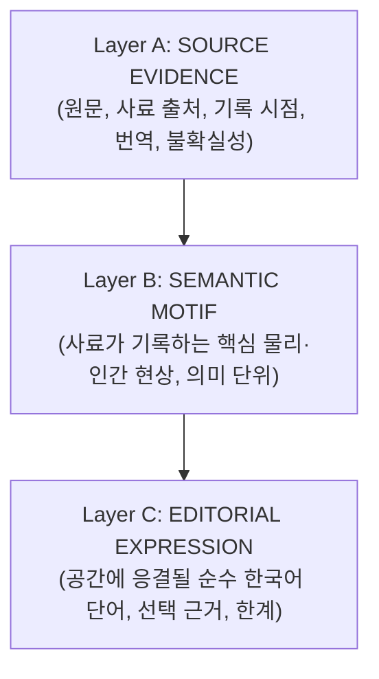

# SEISMOLIVE v4.0 — PHASE D: LIVING MEMORY
## Step 1: Archival Semantic Audit (사료 의미론적 정밀 감사)
### From Historical Evidence to Spatial Meaning

**작업 성격**: 사료 데이터 구조 및 의미 단위 정밀 감사 (Phase D 착수 제1산출물)  
**대상 코퍼스**: [historicalArchiveDB.js](file:///Users/katsina/Downloads/earth/js/data/historicalArchiveDB.js), [instrumentalCatalogDB.js](file:///Users/katsina/Downloads/earth/js/data/instrumentalCatalogDB.js)  
**감사 대상 사건**: 1681 Yangyang, 2016 Gyeongju, 2017 Pohang, 2016 Kumamoto, 2023 Türkiye

---

## 1. 사료 데이터 구조 감사 및 현황 분석

### 1.1 기존 시스템의 데이터 구조 및 한계
현재 코드 베이스([historicalArchiveDB.js](file:///Users/katsina/Downloads/earth/js/data/historicalArchiveDB.js), [instrumentalCatalogDB.js](file:///Users/katsina/Downloads/earth/js/data/instrumentalCatalogDB.js), [textGenerator.js](file:///Users/katsina/Downloads/earth/js/textGenerator.js))는 방대한 사료 원문과 계측 보고서를 보유하고 있으나, 화면에 표출되는 텍스트 계층에서 다음과 같은 **치명적인 설계 결함**이 존재하였다:

1. **문장형 텍스트 표출 (Prohibited Sentence Flooding)**:
   - 프로토타입([prototype_g2_continuous_seismic_world.html](file:///Users/katsina/Downloads/earth/prototype_g2_continuous_seismic_world.html#L1810-L2137))에서 `천년의 탑이 흔들리다`, `화산 분지 대지가 찢어지다`, `아소의 거대한 외륜산이 울리다`, `타우루스 협곡의 침묵을 깨우다` 등 완성된 설명 문장을 통째로 스프라이트에 렌더링함.
   - 이는 관람자의 시선을 텍스트 읽기(Reading)로 강제하여, 지형과 공간의 숭고한 침묵을 훼손하는 설명적 내러티브(Explanatory HUD)로 전락함.
2. **원문과 편집적 창작의 모호한 혼재**:
   - 사료 원문 한문/현대어 번역에 존재하는 어휘(예: `울다`, `퇴조`, `괴암 붕괴`)와 큐레이터가 현대적으로 수식한 문장(예: `천년의 탑이...`)의 증거 수준(Evidence Status)이 화면 상에서 전혀 구별되지 않음.
3. **5대 사건 타이포그래피 프리셋의 구조적 획일화**:
   - 2016 경주, 2017 포항, 2016 구마모토, 2023 튀르키예가 모두 동일한 서체(`Noto Serif KR`), 동일한 크기(76~82px), 동일한 발광 후광(Halo), 동일한 캔버스 크기(1400~1600px)를 공유하여 사건별 고유한 지질학적·역사적 공명이 사라짐.

---

## 2. 사료 3단계 분리 원칙 (Tri-Layer Semantic Structure)

모든 사료 텍스트는 다음 3개의 독립된 계층으로 엄격히 분리하여 감사·관리한다:

- **A. SOURCE EVIDENCE (사료 증거)**:
  - 변조되지 않은 1차 사료(조선왕조실록, 승정원일기) 또는 공식 계측 보고서(KMA, USGS, JMA, AFAD) 원문.
  - 기록 시각, 원문 언어, 번역 공인 여부, 위치/깊이 불확실성.
- **B. SEMANTIC MOTIF (의미 모티프)**:
  - 사료가 증언하는 지질학적·자연적 현상의 본질(예: 산악 음향 공명, 조수 역류, 지표 파열, 액상화).
  - 사건을 이해하는 데 필수적인 핵심 물리 단위.
- **C. EDITORIAL EXPRESSION (편집적 언어 표현)**:
  - **오직 1~2개의 순수 한국어 단어(Word-Level Token)**. 문장 금지.
  - 사료에서 직접 인출(`DIRECT_ARCHIVAL_CITATION`)되었는지, 사료의 현상을 상징적으로 응축한 것(`EDITORIAL_DISTILLATION`)인지 엄밀히 태깅.
  - 단어의 서체 조형성, 음운적 질감, 공간적 배치 적합성.

---

## 3. 5대 벤치마크 사건 사료 정밀 감사 (Event-by-Event Audit)

---

### [Benchmark 1] 1681년 양양 대지진 (`hist_1681_0626`)
- **지리/지질 유형**: 동해안 해역-고산 복합형 (Offshore Alpine Coast)
- **시대/성격**: 전계기 역사 사료 (조선 숙종 7년, 1차 편년체 사료 교차 검증)

#### A. SOURCE EVIDENCE
| 항목 | 내용 |
|:---|:---|
| **원문 (Hanja)** | 1. 肅宗實錄 11卷 7年 5月 11日: `江原道地震 聲如雷 墻屋頹毁 山岳震動 巨巖崩壞 海水如潮退而溢` 2. 承政院日記 7年 5月 14日: `江原監司狀啓 襄陽洛山寺雪嶽山神興寺巖石崩頹 三陟府竹西樓巖석動搖 海水退潮百餘步` |
| **공인 번역** | 1. 강원도에 지진이 일어나 소리가 우레와 같고 담과 집이 무너졌으며 산악이 진동하고 거대한 바위가 붕괴되고 바닷물이 조수가 밀려가듯 하더니 넘쳐흘렀다. 2. 강원감사의 장계에 양양 낙산사와 설악산 신흥사의 암석이 무너져 내리고 삼척 죽서루 바위가 흔들렸으며 바닷물이 백여 보 물러갔다가 밀려왔다. |
| **사료 출처** | 조선왕조실록(숙종실록 권11), 승정원일기(숙종 7년 5월 14일 신유 강원감사 장계), 증보문헌비고 권11 |
| **기록 시점** | 음력 1681년 5월 11일 ~ 5월 14일 (양력 환산: 1681-06-26) |
| **신뢰도/불확실성** | 최고 등급 관찬 사료(HIGH_PRIMARY_CHRONICLE). 진앙은 외해(37.90°N, 129.10°E ±45km), 진원 심도는 `UNKNOWN_UNRECORDED` (계측 불가). |

#### B. SEMANTIC MOTIF
1. **해수 역류 및 해저 노출 (Tsunami Recession & Exposure)**: 바닷물이 조수처럼 100여 보 이상 급격히 물러나 평소 볼 수 없던 해저가 노출됨.
2. **산악 저주파 음향 굉음 (Acoustic Boom / Mountain Roar)**: 단순 지반 진동을 넘어 산맥 전체가 우레처럼 포효함 (`산이 울다`).
3. **고산 화강암 거암 붕락 (Alpine Granitic Rockfall)**: 설악산 신흥사와 양양 낙산사의 거대한 암괴가 중력에 의해 파쇄되어 굴러떨어짐.

#### C. EDITORIAL EXPRESSION (순수 한국어 단어)
| 의미 모티프 | 화면 표출 단어 | 단어 성격 분류 | 선택 근거 및 한계 |
|:---|:---:|:---:|:---|
| 해수 역류 | **`퇴조`** (退潮) | `DIRECT_ARCHIVAL_CITATION` | 승정원일기 `海水退潮百餘步`에서 직접 인출. 바닷물이 수평선 너머로 물러나며 바다의 무대가 열리는 지질학적 사건을 단 두 글자로 응축. |
| 해저 노출 | **`드러나다`** | `EDITORIAL_DISTILLATION` | 승정원일기 `露出` 및 사료의 백여 보 노출 현상을 순우리말 동사 원형으로 응결. 지형 표면에 희미하게 각인. |
| 산악 굉음 | **`울다`** | `DIRECT_ARCHIVAL_CITATION` | 실록 번역본 및 민간 사료의 `산이 울고(山鳴)`에서 직접 인출. 산맥 뒤편 대기에 저주파의 울림으로 발현. |
| 거암 붕락 | **`무너지다`** | `EDITORIAL_DISTILLATION` | `巖石崩頹`, `巨巖崩壞`의 한자어를 배제하고 순우리말 파쇄 동사로 정제. 화강암 암봉 사이에서 자모가 해체됨. |

---

### [Benchmark 2] 2016년 경주 지진 (`hist_2016_gyeongju`)
- **지리/지질 유형**: 내륙 화강암 분지 단층형 (Inland Granite Basin Fault)
- **시대/성격**: 현대 디지털 광대역 지진계 관측 사상 최고 규모 본진 ($M_L 5.8$)

#### A. SOURCE EVIDENCE
| 항목 | 내용 |
|:---|:---|
| **원문 (Official Script)** | "2016년 9월 12일 20시 32분 경북 경주시 남남서쪽 8.7km 지역에서 규모 5.8 지진 발생. 1978년 계기 관측 이래 한반도 내륙 최대 규모 지진으로 전국 대부분 지역에서 유감 진동이 감지되었으며, 첨성대 중심축 변위(약 1mm 북측 기울어짐) 및 다보탑 상부 난간석 파손 발생." |
| **사료 출처** | 기상청(KMA) 9.12 경주지진 정밀분석 보고서 (2016), 국립문화재연구원 경주 지진 문화재 피해조사 보고서 (2016) |
| **기록 시점** | 2016-09-12 20:32:54 KST (11:32:54 UTC) |
| **신뢰도/불확실성** | 최상위 계측 검증(`PRIMARY_OFFICIAL`). 진앙 좌표 오차 ±0.5km, 진원 심도 15.0km (±1.5km), 국소 규모 $M_L 5.8$ / 모멘트 규모 $M_w 5.4$. |

#### B. SEMANTIC MOTIF
1. **지중 전단 파열 굉음 (Subterranean Acoustic Rumble)**: 주향이동 단층이 지하 15km에서 순간 전단 파괴되면서 발생한 천둥 같은 지중 굉음.
2. **역사적 석조 구조물의 미세 변위 (Millennial Resonance / Heritage Tremor)**: 천년 동안 자리를 지킨 첨성대와 석탑이 고유진동수로 공명하여 미세하게 기울어짐.
3. **분지 기반암의 격동 (Basin Bedrock Tremor)**: 단단한 영남 육괴 화강암을 타고 전파된 고주파 S파 지반 요동.

#### C. EDITORIAL EXPRESSION (순수 한국어 단어)
| 의미 모티프 | 화면 표출 단어 | 단어 성격 분류 | 선택 근거 및 한계 |
|:---|:---:|:---:|:---|
| 지중 굉음 | **`우레`** | `EDITORIAL_DISTILLATION` | 지하 단층 파열음의 청각적 본질을 담은 고어적 어휘. 분지 지표면 아래에서 미세하게 발광. |
| 석조물 공명 | **`흔들리다`** | `DIRECT_ARCHIVAL_CITATION` | 관측 보고서의 "전국적인 유감 진동"과 문화재 진동 기록에서 인출. 천년의 침묵이 깨어나는 동사적 상태. |
| 기반암 격동 | **`떨리다`** | `EDITORIAL_DISTILLATION` | 화강암 지반의 고주파 잔류 진동을 표현. 글자 획이 미세하게 진동하며 공간 속으로 분산. |

*금지 문구 퇴출*: 기존의 `천년의 탑이 흔들리다` (9음절 완결 문장)를 완전 배제하고, 오직 **`흔들리다`**, **`우레`**라는 단어의 공간적 공명으로 대체함.

---

### [Benchmark 3] 2017년 포항 지진 (`hist_2017_pohang`)
- **지리/지질 유형**: 해안 대륙붕 연약 퇴적층 역단층형 (Coastal Continental Shelf / Shallow Thrust)
- **시대/성격**: 천발 역단층($M_w 5.4$, 심도 ~7km) 및 국내 관측 사상 최초 지표 액상화(Liquefaction)

#### A. SOURCE EVIDENCE
| 항목 | 내용 |
|:---|:---|
| **원문 (Official Script)** | "2017년 11월 15일 14시 29분 경북 포항시 북구 북쪽 9km 지역에서 규모 5.4 지진 발생. 진원 심도 약 7km의 천발 지진으로 흥해읍 일대 제3기 연약 퇴적층에서 액상화(모래 분출구 및 수분 용출)가 국내 최초로 공식 관측되었으며, 필로티 건물 기둥 파단 및 지표 변위 균열 발생." |
| **사료 출처** | 기상청 포항 지진 백서, 한국지질자원연구원(KIGAM) 포항 지진 정밀 조사 보고서 (2018), *Science* 지열발전 유발지진 논문 (2018) |
| **기록 시점** | 2017-11-15 14:29:31 KST |
| **신뢰도/불확실성** | 최상위 계측 검증(`PRIMARY_OFFICIAL`). 심도는 3~7km 모델 편차 존재(`MODEL_CONSTRAINED_RANGE`). 지표 액상화는 200여 개 분출공 실측 확정. |

#### B. SEMANTIC MOTIF
1. **천부 역단층 충상 (Shallow Overthrust / Rupture)**: 지표면 근처(심도 3~7km)에서 단층 상반이 하반을 타고 기어오르는 천부 충상.
2. **지표 분사 및 액상화 (Sediment Fluidization & Water Spout)**: 지진동으로 과잉간극수압이 발생하여 지하 모래와 물이 분수처럼 지표로 뿜어져 나옴.
3. **지표 균열 및 구조체 전단 파괴 (Structural Shear Fracture)**: 연약 지반의 차등 침하와 지표면 균열.

#### C. EDITORIAL EXPRESSION (순수 한국어 단어)
| 의미 모티프 | 화면 표출 단어 | 단어 성격 분류 | 선택 근거 및 한계 |
|:---|:---:|:---:|:---|
| 액상화 분사 | **`솟다`** | `EDITORIAL_DISTILLATION` | 모래와 지하수가 압력에 의해 분출하는 현상의 본질적 동사. 해안선 연약 지반에서 수직으로 솟아오름. |
| 지표 균열 | **`갈라지다`** | `EDITORIAL_DISTILLATION` | 사료와 보고서의 "지표 파열 및 균열"을 순우리말로 응축. 대지의 선을 따라 글자 획이 쪼개짐. |
| 천부 충상 | **`밀치다`** | `EDITORIAL_DISTILLATION` | 역단층(Thrust) 운동의 지질학적 응력을 형상화한 물리적 동사. |

*금지 문구 퇴출*: 기존의 `모래와 물이 솟구치다`, `외벽이 무너져 내리다`를 완전 배제하고, **`솟다`**, **`갈라지다`**로 정제함.

---

### [Benchmark 4] 2016년 일본 구마모토 지진 (`global_2016_kumamoto`)
- **지리/지질 유형**: 화산 열개 지구대형 (Inland Volcanic Rift / Graben)
- **시대/성격**: 아소 화산 서익 후타가와 단층대 천발 대지진 ($M_w 7.0 / M_j 7.3$, 지표 단층 34km 실측 노출)

#### A. SOURCE EVIDENCE
| 항목 | 내용 |
|:---|:---|
| **원문 (Official Script)** | "平成28年(2016年)4月16日 01時25分 熊本県熊本地方 M7.3 地震。布田川断層帯に沿って最大約2mの地表地震断層が出現し、阿蘇カルデラ西側斜面の大規模崩落が発生。" (일본 기상청 JMA 공식 보고서) |
| **공인 번역** | 2016년 4월 16일 01시 25분 구마모토현 구마모토 지방 규모 7.3 지진. 후타가와 단층대를 따라 최대 약 2m의 지표 지진단층이 출현하였으며, 아소 칼데라 서측 사면의 대규모 산사태 붕락 발생. |
| **사료 출처** | 일본 기상청(JMA), 방재과학기술연구소(NIED), 일본 국토지리원(GSI) InSAR 지표 변위 보고 (2016) |
| **기록 시점** | 2016-04-16 01:25:06 JST (2016-04-15 16:25:06 UTC) |
| **신뢰도/불확실성** | 최상위 계측 검증(`VERIFIED_PRIMARY_INSTRUMENTAL`). 지표 단층 파열 34km 실측. |

#### B. SEMANTIC MOTIF
1. **열개 지구대 지표 파열 (Graben Rifting / Surface Faulting)**: 화산 지구대의 지표면이 칼로 베어낸 듯 갈라지며 최대 2m의 수평·수직 어긋남 발생.
2. **칼데라 사면 붕괴 (Caldera Wall Collapse)**: 세계 최대급 아소 칼데라의 외륜산 사면이 통째로 쏟아져 내림.

#### C. EDITORIAL EXPRESSION (순수 한국어 단어)
| 의미 모티프 | 화면 표출 단어 | 단어 성격 분류 | 선택 근거 및 한계 |
|:---|:---:|:---:|:---|
| 지표 파열 | **`찢기다`** | `EDITORIAL_DISTILLATION` | 단층대가 대지를 열개(Rift)시키는 격렬한 장력을 순우리말로 응축. 단층선을 따라 자모가 양옆으로 분리됨. |
| 칼데라 사면 붕괴 | **`쏟아지다`** | `EDITORIAL_DISTILLATION` | 화산 쇄설물 사면이 중력에 의해 계곡으로 무너져 내리는 동적 궤적. |

*금지 문구 퇴출*: 기존의 `화산 분지 대지가 찢어지다`, `아소의 거대한 외륜산이 울리다`를 완전 배제하고, **`찢기다`**, **`쏟아지다`**라는 단어 본질로 환원함.

---

### [Benchmark 5] 2023년 튀르키예 카흐라만마라슈 지진 (`global_2023_turkey`)
- **지리/지질 유형**: 대륙판 경계 초대형 주향이동 단층형 (Continental Strike-Slip Fault)
- **시대/성격**: 동아나톨리아 단층(EAF) 전 구간 310km 파열 ($M_w 7.8$, 지표 변위 최대 7~9m)

#### A. SOURCE EVIDENCE
| 항목 | 내용 |
|:---|:---|
| **원문 (Official Script)** | "06 Şubat 2023 saat 04:17'de Kahramanmaraş Pazarcık merkezli Mw 7.8 büyüklüğünde deprem meydana gelmiş, Doğu Anadolu Fay Hattı boyunca 300 km'den fazla yüzey kırığı ve 7 metreyi aşan sol yanal ötelenme ölçülmüştür." (AFAD 공식 보고) |
| **공인 번역** | 2023년 2월 6일 04시 17분 카흐라만마라슈 파자르즈크를 진앙으로 규모 7.8 지진 발생. 동아나톨리아 단층선을 따라 300km 이상의 지표 파쇄대와 7m를 초과하는 좌수향 수평 변위 실측. |
| **사료 출처** | 튀르키예 재난위기관리청(AFAD), 칸딜리 관측소(KOERI), 미국지질조사국(USGS) (2023) |
| **기록 시점** | 2023-02-06 04:17:34 TRT (01:17:34 UTC) |
| **신뢰도/불확실성** | 최상위 계측 검증(`VERIFIED_PRIMARY_INSTRUMENTAL`). 지표 파열 길이 310km, 지표 변위 7m+ 실측 확정. |

#### B. SEMANTIC MOTIF
1. **대륙판 경계의 초거대 전단 파쇄 (Continental Megashear / 300km Rupture)**: 아나톨리아 판과 아라비아 판의 경계가 수백 킬로미터에 걸쳐 지퍼가 열리듯 찢어짐.
2. **타우루스 산맥 협곡의 침묵 파괴 (Canyon Seismic Roar)**: 고대 문명의 산맥과 협곡 전체가 초저주파 표면파로 뒤흔들림.

#### C. EDITORIAL EXPRESSION (순수 한국어 단어)
| 의미 모티프 | 화면 표출 단어 | 단어 성격 분류 | 선택 근거 및 한계 |
|:---|:---:|:---:|:---|
| 초거대 전단 | **`갈라지다`** / **`트이다`** | `EDITORIAL_DISTILLATION` | 300km 대륙 파쇄의 거대한 균열을 순우리말 동사로 형상화. 광활한 대륙 지평선 너머로 단어의 획이 갈라짐. |
| 협곡 진동 | **`울리다`** | `EDITORIAL_DISTILLATION` | 타우루스 산맥 협곡의 장엄한 암반 공명. 깊은 음영 속에서 은청색으로 공명. |

*금지 문구 퇴출*: 기존의 `대륙의 단층이 솟구치다`, `타우루스 협곡의 침묵을 깨우다`를 완전 배제하고, **`트이다`**, **`울리다`**로 절제함.

---

## 4. 감사 결론 및 Phase D 아키텍처 연계 방향

1. **설명적 문장의 완전 박멸**:
   - `천년의 탑이 흔들리다`, `화산 분지가 찢어지다`와 같은 10음절 내외의 저널리즘적 문장은 갤러리 미디어아트로서의 품격을 떨어뜨리고 관람자의 시각적 공간 몰입을 방해함.
   - 사료의 정수를 응축한 **1~2단어(2~4음절)의 순수 한국어 단어 모티프**로 전면 전환한다.
2. **증거 수준(Evidence Status)의 데이터 분리**:
   - 직접 인출 어휘(`DIRECT_ARCHIVAL_CITATION`: 예: `퇴조`, `울다`, `흔들리다`)와 의미적 응축 어휘(`EDITORIAL_DISTILLATION`: 예: `드러나다`, `솟다`, `찢기다`)를 데이터 스키마 차원에서 엄격히 구분한다.
3. **독립된 시공간 라이프사이클 부여**:
   - 추출된 단어들은 기계적인 파동 정점에 붙어 날아다니지 않고, 지형의 특정한 지질학적 무대(해안 단애, 단층선, 암봉 능선) 위에서 독립된 시간축(Latent → Emergence → Formation → Resonance → Dissolution → Residue)에 따라 호흡하도록 설계한다.
