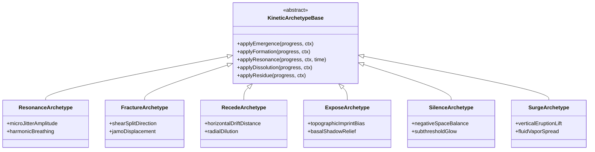
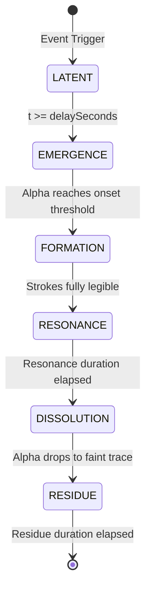

# SEISMOLIVE v4.0 — PHASE D: LIVING MEMORY
## Step 2 & 4: Universal Semantic Architecture & Independent Temporal Orchestration
### The Architectural Blueprint for Spatial Living Memory

**작업 성격**: Phase D 시스템 아키텍처 및 시공간 오케스트레이션 명세 (제2산출물)  
**결합 기반**: WGS84 3-Tier Earth Foundation (Phase A/B/C 영구 보존 및 동결 전제)  
**핵심 목표**: 파동장 물리 시간과 분리된 독립적 사료 의미 시간축 구축, 5대 키네틱 아키타입 정의, 6단계 생명주기 상태 머신 구현

---

## 1. 아키텍처 철학: 공간 속의 기억 (Living Memory in Continuous Space)

기존의 실패한 접근(파동의 정점에 텍스트를 기계적으로 부착하거나, 평면 UI 카드로 띄우거나, 거대한 3D 비석을 세우는 방식)을 영구히 배제한다.

```
"Earth is the Stage. Earthquake is the Event. History is the Memory.
 Light, Space, Motion and Typography are the Language."
```

1. **물리와 기억의 시간적 분리 (Temporal Decoupling)**:
   - 지진파는 수천 m/s의 탄성파 속도($V_p, V_s, V_R$)에 따라 수 초 내에 수백 km를 주파한다.
   - 반면, 인간 사료의 기억은 지진 이전의 적막(Latent), 파열의 순간(Emergence), 대지의 흔들림과 공명(Resonance), 그리고 수 세기에 걸친 잔흔(Residue)이라는 **독자적인 시공간 리듬**을 갖는다.
   - 따라서 타이포그래피는 물리적 도달 시각에 종속되지 않고 독립적인 의미 생명주기를 가진다.
2. **단어 단위의 공간 응결 (Word-Level Condensation)**:
   - 화면에 문장을 나열하지 않는다.
   - 사료의 정수가 담긴 단 1~2개의 순수 한국어 단어가 지형의 특정한 무대(단애, 단층선, 해구, 능선) 위 대기 속에서 안개처럼 응결되었다가 산란된다.

---

## 2. 전체 시스템 구조도 (System Architecture Diagram)

```mermaid
flowchart TD
    subgraph Data Layer
        DB_HIST["historicalArchiveDB.js\n(Era 1 사료)"]
        DB_INST["instrumentalCatalogDB.js\n(Era 2/3/4 계측)"]
    end

    subgraph Phase D: Living Memory Core
        REGISTRY["UniversalSemanticRegistry\n(사료 의미 단위 파싱 및 등록)"]
        ORCH["IndependentTemporalOrchestrator\n(독립 메모리 타임라인 관리)"]
        RESOLVER["SpatialAnchorResolver\n(지형 표고 및 법선 공간 결속)"]
        KINETIC["KineticArchetypeSystem\n(RESONANCE, FRACTURE, RECEDE, EXPOSE, SILENCE)"]
    end

    subgraph Three.js Continuous 3D World (Phase A/B/C Baseline)
        WGS84_COORD["Geodetic Ellipsoid Engine\n(Center-Relative Origin)"]
        TERRAIN_LOD["Terrain Lifecycle Manager\n(Tier 1/2 DEM Surface)"]
        ATMOSPHERE["Atmospheric Shader\n(Rayleigh/Mie Scattering)"]
        RENDER_GROUP["LivingMemory_Root (THREE.Group)\n(Dual-Pass Offscreen Sprites)"]
    end

    Data Layer --> REGISTRY
    REGISTRY --> ORCH
    WGS84_COORD --> RESOLVER
    TERRAIN_LOD --> RESOLVER
    RESOLVER --> ORCH
    ORCH --> KINETIC
    KINETIC --> RENDER_GROUP
    ATMOSPHERE -.->|Cushion Shading| RENDER_GROUP
```

---

## 3. 핵심 모듈 설계 명세

### 3.1 `SemanticUnit` 데이터 스키마
하나의 지진 사건은 사료의 복합성에 따라 1개에서 최대 4개의 `SemanticUnit`을 가진다. 각 단위는 고유한 공간 위치와 생명주기를 갖는다.

```typescript
interface SemanticUnit {
  // 1. 고유 식별자 및 메타데이터
  id: string;                      // 예: 'unit_1681_recede'
  eventId: string;                 // 예: 'hist_1681_0626'
  
  // 2. 사료 증거 계층 (Layer A)
  sourceEvidence: {
    originalScript: string;        // 원문 (예: '海水如潮退而溢')
    sourceDocument: string;        // 사료 출처 (예: '조선왕조실록 숙종 11권')
    recordingDate: string;         // 기록 시각 (예: '1681-06-26')
    evidenceStatus: 'DIRECT_ARCHIVAL_CITATION' | 'EDITORIAL_DISTILLATION';
    credibility: 'PRIMARY_CHRONICLE' | 'PRIMARY_OFFICIAL' | 'SCHOLARLY_RECONSTRUCTION';
    uncertaintyNote?: string;
  };

  // 3. 의미 모티프 계층 (Layer B)
  semanticMotif: {
    phenomenonTag: string;         // 예: 'TSUNAMI_RECESSION', 'ALPINE_ROAR'
    descriptionKo: string;         // '조수가 밀려가는 듯하더니 해저가 노출됨'
  };

  // 4. 편집적 언어 표현 (Layer C)
  editorialExpression: {
    wordToken: string;             // 화면에 응결될 순수 한국어 단어 (예: '퇴조', '울다')
    charCount: number;             // 음절 수 (최대 4자 엄수)
    etymologyBasis: string;        // 단어 선택 학술/사료적 근거
  };

  // 5. 공간 무대 결속 (Spatial Anchor)
  spatialAnchor: {
    zoneType: 'ZONE_OCEAN_SHELF' | 'ZONE_COASTAL_BLUFF' | 'ZONE_INLAND_BASIN' | 'ZONE_ALPINE_RIDGE' | 'ZONE_FAULT_TRACE';
    targetLat: number;             // WGS84 위도
    targetLon: number;             // WGS84 경도
    surfaceOffsetKm: number;       // DEM 표고 위 대기 부유 높이 (0.3 ~ 2.5km)
    tangentOrientation: 'VIEW_ALIGNED' | 'SURFACE_SLOPE_ALIGNED' | 'HORIZON_LEVEL';
  };

  // 6. 독립 시공간 오케스트레이션 (Temporal Lifespan)
  temporalLifespan: {
    delaySeconds: number;          // 이벤트 트리거 후 출현 지연 (s)
    t_emergence: number;           // 출현 구간 지속 시간 (s)
    t_formation: number;           // 자모 형성 구간 지속 시간 (s)
    t_resonance: number;           // 의미 공명 구간 지속 시간 (s)
    t_dissolution: number;         // 해체 소멸 구간 지속 시간 (s)
    t_residue: number;             // 미세 잔흔 지속 시간 (s)
  };

  // 7. 시각 및 키네틱 아키타입 (Visual & Kinetic)
  kineticArchetype: 'RESONANCE' | 'FRACTURE' | 'RECEDE' | 'EXPOSE' | 'SILENCE' | 'SURGE';
  visualStyling: {
    fontFamily: string;            // 'Noto Serif KR', 'Batang'
    baseOpacity: number;           // 0.45 ~ 0.75
    textColor: string;             // 은청색, 월광 백색, 흑청색 계열
    ambientCushionRadius: number;  // 배경 암전 쿠션 반경
  };
}
```

---

## 4. 5대 키네틱 아키타입 명세 (The Five Kinetic Archetypes)

단어의 움직임은 기계적인 CSS 애니메이션이나 물리 엔진 튀김이 아니라, **지질학적 사건의 성격이 한글 자모의 획(Strokes)과 여백을 통해 드러나는 조형적 전이**다.



### 1. `RESONANCE` (공명: 울림과 진동)
- **적용 현상**: 산악 굉음(`울다`), 지중 천둥 소리(`우레`), 천년 고탑의 진동(`흔들리다`).
- **키네틱 특성**:
  - 자모의 획이 파괴되지 않고, 획 경계가 차가운 월광 대기 속에서 미세하게 진동(Micro-Jitter: ±0.5px)함.
  - 서체 주변에 부드러운 산란 광채(Atmospheric Bloom Cushion)가 호흡하듯 팽창하고 수축함.
  - 음절 전체가 음향적 저주파 리듬(0.8 ~ 1.5 Hz)에 맞추어 공간에 머무름.

### 2. `FRACTURE` (파쇄: 균열과 붕괴)
- **적용 현상**: 설악산 거암 붕락(`무너지다`), 필로티 기둥 전단 파단, 외벽 조적재 붕괴.
- **키네틱 특성**:
  - 한글의 자음과 모음(초성, 중성, 종성)이 형성된 직후, 지질학적 전단 단층선(Fault Trace)을 따라 미세한 전단 변위(Shear Shift)가 발생.
  - 획이 산산이 부서져 날아가는 게임 이펙트를 금지하고, 획과 획 사이의 간극이 1~3px 벌어지며 중력 방향으로 조용히 침하함.

### 3. `RECEDE` (퇴조: 물러남과 비움)
- **적용 현상**: 양양 해역 쓰나미 인발파(`퇴조`), 해안선 후퇴.
- **키네틱 특성**:
  - 해안선 단애 너머 수평선 방향으로 단어가 수평으로 미끄러지듯 이동함(Horizontal Radial Drift).
  - 농도가 짙은 상태에서 수평선 너머로 퍼져나가며 투명도가 낮아져 공간 속으로 증발함.
  - 바닷물이 빠져나간 허공의 빈자리를 시각적으로 상징.

### 4. `EXPOSE` (노출: 드러남과 각인)
- **적용 현상**: 드러난 해저 백여 보(`드러나다`), 단층선의 지표 노출.
- **키네틱 특성**:
  - 대기 중에 뜨지 않고 지표면/해저 DEM 표면에 극도로 밀착(Elevation Offset 최소화).
  - 마치 젖은 갯벌이나 암반 위에 새겨진 석각(Petroglyph)처럼, 표면 음영과 맞물리며 은은하게 떠올랐다가 대지 속으로 스며듦.

### 5. `SILENCE` (침묵: 부재와 미상)
- **적용 현상**: 역사적 단절, 계측기록 이전의 불확실성, 인간 기록의 부재.
- **키네틱 특성**:
  - 극도의 낮은 불투명도(0.15 ~ 0.35)로 존재하듯 존재하지 않는 경계에 머무름.
  - 글자의 형태가 온전히 읽히기 직전에 공간의 암전 속으로 자연스럽게 침잠함.

### 6. `SURGE` (분사: 솟구침) — 신규 제안
- **적용 현상**: 포항 액상화 모래/지하수 분출(`솟다`).
- **키네틱 특성**:
  - 지반 아래에서 수직으로 솟구치듯 글자의 종성과 초성이 하부에서 상부로 응축되며 융기함.

---

## 5. 6단계 생명주기 상태 머신 (The 6-Stage Temporal Lifecycle)

파동장의 물리 시간과 독립된 사료 의미 생명주기는 다음 6개 상태를 전이한다:



| 생명주기 상태 | 소요 시간 (평균) | 시각적 조형 상태 | 알파 및 획 변형 규칙 |
|:---|:---:|:---|:---|
| **1. LATENT (잠복)** | 0 ~ 3.5s | 공간에 아무것도 보이지 않음. 지형과 별빛만 고요히 존재. | $\alpha = 0.0$ |
| **2. EMERGENCE (발아)** | 0.8 ~ 1.5s | 서늘한 대기 안개 속에서 은청색 응결핵이 발생. | $\alpha: 0.0 \to 0.35$, 가우시안 블러 해제 시작 |
| **3. FORMATION (형성)** | 1.0 ~ 1.8s | 한글의 획(초성·중성·종성)이 음향적 질서에 따라 응집. | $\alpha: 0.35 \to 0.70$, 획의 두께와 선명도 확립 |
| **4. RESONANCE (공명)** | 1.8 ~ 3.0s | 완전한 가독성을 유지하며 아키타입별 미세 진동·호흡. | $\alpha \approx 0.65 \sim 0.75$, 최고 선명도 및 공간 결속 |
| **5. DISSOLUTION (해체)** | 1.5 ~ 2.5s | 의미가 공간으로 흩어짐. 획의 경계가 산란광으로 분산. | $\alpha: 0.70 \to 0.15$, 아키타입별 궤적 변위 |
| **6. RESIDUE (잔흔)** | 1.0 ~ 3.5s | 지형 표면에 희미한 흔적만 남아 있다가 무(無)로 환원. | $\alpha: 0.15 \to 0.0$, 완전한 소멸 |

*중요 규칙*: 5개 사건의 모든 단어가 이 6단계를 기계적으로 동일하게 거치지 않는다. `SILENCE`는 FORMATION을 건너뛰고 DISSOLUTION으로 직행할 수 있으며, `EXPOSE`는 RESIDUE 구간이 4초 이상 길게 유지되어 지표에 각인된다.

---

## 6. 공간 결속 좌표 변환 (Spatial Anchor Resolution)

타이포그래피가 2D 화면 스크린 오버레이가 아닌 **3D 연속 세계의 유기적 구성요소**가 되기 위한 기하학적 파이프라인:

1. **지리 좌표 $\to$ WGS84 ECEF 변환**:
   $$\mathbf{X}_{\text{ecef}} = \text{GeodeticToECEF}(\phi, \lambda, h_{\text{dem}} + h_{\text{offset}})$$
2. **카메라 중심 상대 좌표계 (Center-Relative Origin)**:
   $$\mathbf{P}_{\text{scene}} = \mathbf{X}_{\text{ecef}} - \mathbf{X}_{\text{origin}}$$
   (Phase A에서 입증된 Float32 정밀도 유지 및 지터 방지 보장)
3. **지형 사면 추종 및 기립 법선 (Normal Alignment)**:
   - 해저 각인 단어(`EXPOSE`): 지형 국소 법선 $\mathbf{n}_{\text{topo}}$에 평행하게 누워 지표면과 일체화.
   - 대기 공명 단어(`RESONANCE`, `RECEDE`): 카메라 시선 벡터에 직교하되 지평선 위로 기립(Horizon-Billboard)하여 산맥 뒤로 가려지는 차폐(Occlusion) 효과 부여.
4. **시야각 및 거리별 가독성 보정 (Distance-Adaptive Scale)**:
   - 카메라 거리가 멀어지면 스프라이트가 과도하게 작아져 픽셀 노이즈가 되는 것을 방지하기 위해, 거리 비례 완화 스케일링 적용:
     $$S(d) = S_0 \cdot \left(\frac{d}{d_{\text{ref}}}\right)^{0.35}$$
     (극단적인 게임식 빌보드가 아닌, 대기 원근감 속에서 형태를 잃지 않는 은은한 적응형 스케일)

---

## 7. 구현 로드맵 및 단계별 검증 기준

- **Step 1 완료**: 사료 의미론적 정밀 감사 ([archival_semantic_audit.md](file:///Users/katsina/.gemini/antigravity/brain/17a06635-381a-4696-af01-da0acfb6b284/archival_semantic_audit.md))
- **Step 2 & 4 완료**: 본 아키텍처 및 시공간 오케스트레이션 명세 수립
- **Step 3 연계**: [phase_d_visual_direction.md](file:///Users/katsina/.gemini/antigravity/brain/17a06635-381a-4696-af01-da0acfb6b284/phase_d_visual_direction.md)에서 시각 스타일, 고해상도 오프스크린 캔버스 래스터화, 여백과 음영 lookdev 상술
- **Step 5 검증**: 1681 양양 프로토타입 구현 및 5대 벤치마크 브라우저 실행 검증
