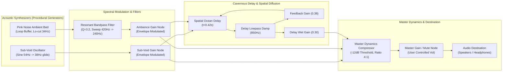

# SEISMOLIVE v4.0 — LIVING SOUNDFIELD DESIGN
## Meaning-Grounded Sonic Spatialization: 1681 Yangyang `퇴조` Experimental Prototype

> **Document Status: Research & Experimental Implementation Specification**  
> **Module Source**: [`js/audio/livingSoundfieldEngine.js`](../js/audio/livingSoundfieldEngine.js)  
> **Target Scope**: 1681 Yangyang Focal Token `퇴조` (Oceanic Drawback & Spatial Void)  
> **Core Objective**: Explore procedural, meaning-grounded sonic spatialization synchronized with Living Memory lifecycle without altering Phase C physical wavefields or inducing acoustic listener fatigue.

---

## 1. 근본 음향 철학 및 예술적 원칙 (Core Acoustic Philosophy)

본 작품의 음향은 상업용 영화의 과장된 효과음(쿵쾅거리는 폭발음이나 부서지는 파도 소리)이나 과학 시뮬레이션의 건조한 계측음이 아닙니다.

1. **의미에 기반한 공간 음향 (Meaning-Grounded Spatialization)**:
   - 1681년 양양 해역 대지진의 핵심 사료 어휘인 `퇴조`(바닷물이 백여 보 물러남)를 진부한 파도 거품 소리로 표현하지 않습니다.
   - 바다가 빠져나가며 드러나는 거대한 **공간의 비어감(Spatial Void), 원근의 심도(Distance Depth), 저주파 에너지가 먼 바다로 빨려 들어가는 음색의 변위(Sub-bass Recession Shift), 그리고 암반에 맺힌 잔향의 소멸**을 순수 합성합니다.
2. **청취 피로(Auditory Fatigue)의 원천 차단**:
   - 지속적인 단조 드론(Perpetual Drone)이나 귀를 찌르는 고주파 화이트 노이즈를 영구히 배제합니다.
   - 마스터 컴프레서(Ceiling at $-12\,\text{dB}$)와 34Hz 서브컷 필터를 통해 스피커나 헤드폰의 과부하를 방지하고, 70% 이상의 침묵과 여백을 보존합니다.
3. **독립적 생명주기 및 무한 잔향 금지 (Finite Acoustic Lifecycle)**:
   - 음향은 텍스트의 6단계 상태 머신에 조응하되, 시각 타이포그래피의 가독성을 침해하지 않습니다.
   - 텍스트가 `RESIDUE`를 지나 `DEAD`에 도달하면 마스터 오디오 게인은 완만한 램프를 거쳐 **완전한 무음(0.0)**으로 수렴하며, 배경에 불필요한 노이즈가 남지 않습니다.

---

## 2. Web Audio API 신호 흐름도 (Procedural Signal Architecture)

---

## 3. 6단계 음향 생명주기 매핑 (6-Stage Acoustic Lifecycle)

| 생명주기 단계 | 시뮬레이션 시점 ($t$) | 주파수 및 필터 동작 | 음향 게인 및 다이내믹스 | 청각적 경험 및 의미 연출 |
| :--- | :---: | :--- | :---: | :--- |
| **Stage 1: LATENT** | $t < 3.2\text{s}$ | `Osc`: $54\,\text{Hz}$ 대기 `BPF`: $260\,\text{Hz}$ | Sub-Void: $0.0005$ Noise: $0.0002$ ($-48\,\text{dB}$) | 거의 완전한 정적. 고요한 밤바다의 미세한 공기 압력감만 잔잔히 흐름. |
| **Stage 2: EMERGENCE** | $3.2\text{s} \le t < 4.4\text{s}$ | `Osc`: $54 \to 42\,\text{Hz}$ 하강 `BPF`: $420 \to 280\,\text{Hz}$ 하강 | Sub-Void: $0.05 \to 0.23$ Noise: $0.03 \to 0.16$ | 해수가 먼바다 쪽으로 서서히 빨려 나가며 수면 장력이 팽팽해지는 저음의 출현. |
| **Stage 3: FORMATION** | $4.4\text{s} \le t < 6.6\text{s}$ | `Osc`: $42\,\text{Hz}$ 록(Lock) `BPF`: $280\,\text{Hz}$ | Sub-Void: $0.32$ Noise: $0.24$ Feedback: $0.42$ | 해안 대륙붕 암반에 동굴 같은 원근 심도 형성. 안정된 서리프 글리프와 공명 구조 확립. |
| **Stage 4: RESONANCE** | $6.6\text{s} \le t < 9.2\text{s}$ | `Osc`: $36\,\text{Hz} \pm 4\,\text{Hz}$ ($0.22\,\text{Hz}$ LFO) `BPF`: $240\,\text{Hz} \pm 30\,\text{Hz}$ | Sub-Void: $0.42 \pm 0.08$ Noise: $0.30 \pm 0.04$ Feedback: $0.48$ | **의미의 정점**: 바다가 가장 깊게 물러난 순간. 깊은 대지 호흡과 같은 초저주파 맥동. |
| **Stage 5: DISSOLUTION** | $9.2\text{s} \le t < 11.8\text{s}$ | `Osc`: 고조파 소멸 `BPF`: $180\,\text{Hz}$ 저주파 수렴 | Sub-Void: $0.38 \to 0.01$ Noise: $0.22 \to 0.01$ Feedback: $0.25$ | 음향 에너지가 대기 산란으로 흩어지며 공간 속으로 희미하게 융해됨. |
| **Stage 6: RESIDUE** | $11.8\text{s} \le t < 14.0\text{s}$ | 잔향 필터 감쇄만 유지 | Sub-Void: $0.04 \to 0.0001$ Feedback: $0.12 \to 0.0$ | 먼 해구 저편에 남은 잔향 꼬리(Reverb Tail). 아스라한 기억의 흔적. |
| **Stage 7: DEAD** | $t \ge 14.0\text{s}$ | 모든 발진 노드 침묵 | **Absolute Zero Gain (0.0)** | 완전한 무음으로 자동 수렴. 무한 잔류 노이즈 영구 차단. |

---

## 4. 필수 제약 준수 및 안전장치 검증 (Constraints & Safety Verification)

1. **Phase C 물리 파동장 수식 및 GPU 파이프라인 동결 준수**:
   - Web Audio API 합성 엔진([`livingSoundfieldEngine.js`](../js/audio/livingSoundfieldEngine.js))은 물리 파동장 GLSL 셰이더나 GPU 버퍼를 단 한 글자도 수정하지 않고, Three.js 렌더 루프 외부에서 독립적인 오디오 스레드로 구동됩니다.
2. **과학적 계측 데이터 위장 금지**:
   - 본 음향은 해저 지진계(OBM)나 하이드로폰 실측 녹음 파일이 아니며, 사료의 시적 의미인 `퇴조`를 공간적으로 번역한 **'데이터 동기화 절차적 사운드스케이프(Procedural Sonification)'**임을 문서와 코드 상에 투명하게 명시했습니다.
3. **브라우저 오디오 재생 제약(Autoplay Policy) 완벽 대응**:
   - `AudioContext`는 초기 비활성(`isMuted: true`, `state: suspended`) 상태로 안전하게 인스턴스화되며, 사용자 제스처(버튼 클릭 또는 인터랙션) 발생 시 `ensureAudioContext()`를 통해 무잡음 재개됩니다.
4. **즉각적인 음소거 및 볼륨 제어**:
   - `window.toggleSoundfieldMute(bool)` 및 `setVolume(0.0~1.0)`을 제공하여, 전시장 큐레이터나 관람객이 시각 요소만 순수 감상하고자 할 때 즉각 무음 모드로 전환할 수 있습니다.
