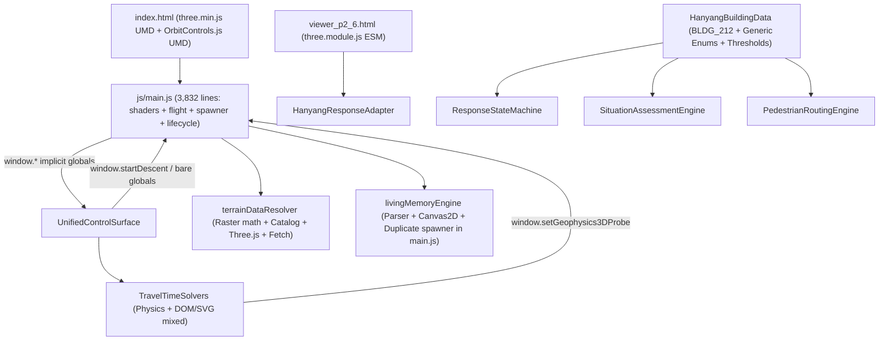
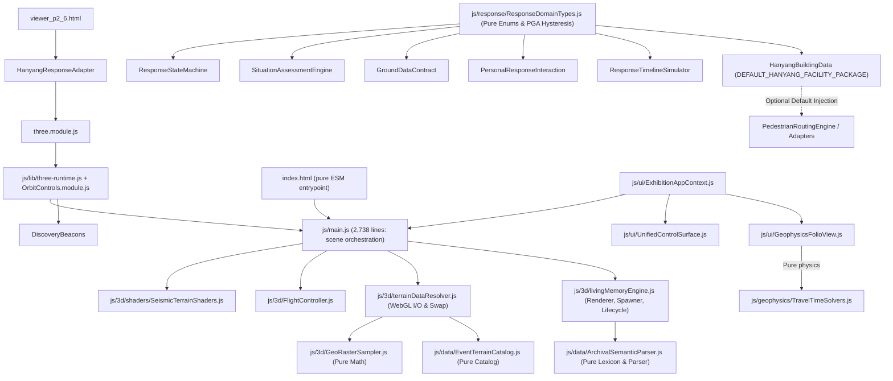

# SEISMOLIVE v4.0 — Phase 3 Architecture Refactoring Final Report (`R1 → R2 → R3`)

## 1. Executive Summary

Phase 3 autonomous architecture refactoring (`Stage R1 → Stage R2 → Stage R3`) has been completed cleanly while preserving 100% of SEISMOLIVE v4.0's scientific integrity, Nocturnal Monolith art direction, pure Korean archival typography, and continuous WGS84/ENU coordinate spatial continuity.

Key architectural achievements across the three sequential stages:

| Stage | Primary Goal | Key Deliverables & Measurable Impact |
| :--- | :--- | :--- |
| **Stage R1** | **Domain / Facility Separation & PGA Policy** | Extracted facility-agnostic enums & PGA hysteresis policy into [ResponseDomainTypes.js](file:///Users/katsina/Downloads/earth/js/response/ResponseDomainTypes.js); decoupled all generic response engines from concrete `BLDG_212_ENG1` data via injectable `FacilityPackage`; unified 3D polyline & routing graph into a single source of truth (`HANYANG_OUTDOOR_GRAPH`); fixed the Stair 3 (`Way 409637898`) & Stair 4 (`Way 187436400`) highlight off-by-one bug; reconciled `0.05g` onset vs. `0.02g` quiescence hysteresis. |
| **Stage R2** | **Domain / I/O / Presentation Separation** | Separated pure physics ([TravelTimeSolvers.js](file:///Users/katsina/Downloads/earth/js/geophysics/TravelTimeSolvers.js), 92 lines) from DOM/SVG rendering ([GeophysicsFolioView.js](file:///Users/katsina/Downloads/earth/js/ui/GeophysicsFolioView.js), 398 lines); split [terrainDataResolver.js](file:///Users/katsina/Downloads/earth/js/3d/terrainDataResolver.js) into pure raster math ([GeoRasterSampler.js](file:///Users/katsina/Downloads/earth/js/3d/GeoRasterSampler.js), 160 lines), terrain catalog/sidecar resolver ([EventTerrainCatalog.js](file:///Users/katsina/Downloads/earth/js/data/EventTerrainCatalog.js), 694 lines), and WebGL lifecycle manager (628 lines); extracted zero-DOM [ArchivalSemanticParser.js](file:///Users/katsina/Downloads/earth/js/data/ArchivalSemanticParser.js) (844 lines) from [livingMemoryEngine.js](file:///Users/katsina/Downloads/earth/js/3d/livingMemoryEngine.js) (1,053 lines); fixed shadowed `window` variable (`obsWindow`) in [StationWaveformBridge.js](file:///Users/katsina/Downloads/earth/js/data/StationWaveformBridge.js). |
| **Stage R3** | **Three.js ESM Unification & `main.js` Modularization** | Removed global UMD `three.min.js` & `OrbitControls.js` from [index.html](file:///Users/katsina/Downloads/earth/index.html) and unified onto ES module [three-runtime.js](file:///Users/katsina/Downloads/earth/js/lib/three-runtime.js) + [OrbitControls.module.js](file:///Users/katsina/Downloads/earth/js/lib/OrbitControls.module.js); extracted 7 GLSL shaders into [SeismicTerrainShaders.js](file:///Users/katsina/Downloads/earth/js/3d/shaders/SeismicTerrainShaders.js) (696 lines) and camera trajectory interpolation into [FlightController.js](file:///Users/katsina/Downloads/earth/js/3d/FlightController.js) (64 lines); introduced explicit [ExhibitionAppContext.js](file:///Users/katsina/Downloads/earth/js/ui/ExhibitionAppContext.js) (150 lines) removing bare global lookups & fixing dormant strict-mode bugs in [UnifiedControlSurface.js](file:///Users/katsina/Downloads/earth/js/ui/UnifiedControlSurface.js); reduced [main.js](file:///Users/katsina/Downloads/earth/js/main.js) from 3,832 to 2,738 lines (`-1,094` lines, `-28.5%`) and connected official `LivingMemoryEngine` & `TerrainAwareSpawner`. |

All **26 JavaScript test suites (Deno)**, **1 Python verification suite**, and **Playwright headless Chromium E2E checks** (`index.html` and `viewer_p2_6.html` under `.cfignore` filtering) pass **100% (`0` failures, `0` console errors, `0` page errors)**.

---

## 2. Stage R1 Results — Domain / Facility Separation & Scientific Consistency

### 2.1 Generic Domain Enums vs. Concrete Facility Data
- Created [js/response/ResponseDomainTypes.js](file:///Users/katsina/Downloads/earth/js/response/ResponseDomainTypes.js) (111 lines) holding facility-agnostic domain enums and motion policies:
  - `DATA_PROVENANCE_SOURCE`, `VERIFICATION_STATUS`, `SEISMIC_MOTION_POLICY`
  - `isProtectiveShakingOnset`, `isInstrumentMotionDetected`, `isQuiescenceSubsided`
  - `ASSESSMENT_URGENCY`, `LOCATION_CERTAINTY`, `MOBILITY_PROFILE`, `CONFLICT_RESOLUTION_STRATEGY`
  - `PATH_TYPE`, `USER_MOBILITY_PROFILE`, `LINK_STATE`
- Decoupled [ResponseStateMachine.js](file:///Users/katsina/Downloads/earth/js/response/ResponseStateMachine.js), [SituationAssessmentEngine.js](file:///Users/katsina/Downloads/earth/js/response/SituationAssessmentEngine.js), [GroundDataContract.js](file:///Users/katsina/Downloads/earth/js/response/GroundDataContract.js), [PersonalResponseInteraction.js](file:///Users/katsina/Downloads/earth/js/response/PersonalResponseInteraction.js), and [ResponseTimelineSimulator.js](file:///Users/katsina/Downloads/earth/js/response/ResponseTimelineSimulator.js) so they have **zero direct imports** from concrete [HanyangBuildingData.js](file:///Users/katsina/Downloads/earth/js/response/HanyangBuildingData.js), while re-exporting symbols from [HanyangBuildingData.js](file:///Users/katsina/Downloads/earth/js/response/HanyangBuildingData.js), [SituationAssessmentEngine.js](file:///Users/katsina/Downloads/earth/js/response/SituationAssessmentEngine.js), and [PedestrianRoutingEngine.js](file:///Users/katsina/Downloads/earth/js/response/PedestrianRoutingEngine.js) for full backward compatibility.

### 2.2 FacilityPackage Dependency Injection & Multi-Building Generality
- Packaged Hanyang Engineering Building 1 (`BLDG_212_ENG1`) metadata, 3F provisional indoor graph, 1F SE portal connector, unified `HANYANG_OUTDOOR_GRAPH`, stadium shelter, and 3D viewpoints into `DEFAULT_HANYANG_FACILITY_PACKAGE` in [HanyangBuildingData.js](file:///Users/katsina/Downloads/earth/js/response/HanyangBuildingData.js).
- Added `facilityPackage` constructor injection (`loadFacilityPackage(...)`, `loadFacility(...)`) to:
  - [PedestrianRoutingEngine.js](file:///Users/katsina/Downloads/earth/js/response/PedestrianRoutingEngine.js)
  - [HanyangResponseAdapter.js](file:///Users/katsina/Downloads/earth/js/response/HanyangResponseAdapter.js) (also supporting dual constructor signatures `(scene, options)` and `(options)` used by viewers and unit tests)
  - [GlobalLocalCameraTransition.js](file:///Users/katsina/Downloads/earth/js/response/GlobalLocalCameraTransition.js)
  - [ResponseUIAdapter.js](file:///Users/katsina/Downloads/earth/js/response/ResponseUIAdapter.js)
- Verified generality in [tests/test_r1_architecture_refactoring.js](file:///Users/katsina/Downloads/earth/tests/test_r1_architecture_refactoring.js) (Category 3) by injecting a completely synthetic 4-story second building facility (`BLDG_SOC_001`) with custom indoor rooms, 1 staircase segment (`OUT_STEPS`), 1 step-free detour, and an independent shelter—confirming exact synthetic distance computation (`96m` outdoor shortest / `125m` step-free / `150m` full), isolated 3D stair rendering, dynamic camera presets, and automatic stair-closure detour replanning (`150m → 179m STEP_FREE`).

### 2.3 Stair 3 & Stair 4 Highlight Off-By-One Root Cause & Fix
- **Root Cause**: [HanyangResponseAdapter.js](file:///Users/katsina/Downloads/earth/js/response/HanyangResponseAdapter.js) previously maintained a duplicated coordinate array (`shortestWaypoints`) separate from `PedestrianRoutingEngine`'s graph and sliced magic array indices (`[6..7]` and `[9..10]`) to highlight outdoor stair segments. Because intermediate polyline nodes shifted array indices, slices `[6..7]` and `[9..10]` highlighted flat pedestrian segments immediately preceding **Stair 3 (`Way 409637898`)** and **Stair 4 (`Way 187436400`)** rather than the true staircases.
- **Fix**: Consolidated outdoor nodes, 3D `localPos` coordinates, edge `waypoints`, and `hasStairs` / `wayId` / `edgeId` flags into `HANYANG_OUTDOOR_GRAPH`. `HanyangResponseAdapter.js` now computes 3D polylines (`buildRouteVectors`) directly from `router.findOutdoorShortestPath().edges` and renders `Stairs_Hazard_Segments` strictly by filtering `edge.hasStairs === true`, attaching exact `userData.stairSegments` metadata (`wayId`, `edgeId`).

### 2.4 PGA Threshold Hysteresis Unification (`0.05g` / `0.02g`)
- Resolved the discrepancy between `0.02g` in [PersonalResponseInteraction.js](file:///Users/katsina/Downloads/earth/js/response/PersonalResponseInteraction.js) and `0.05g` in [ResponseStateMachine.js](file:///Users/katsina/Downloads/earth/js/response/ResponseStateMachine.js) / [SituationAssessmentEngine.js](file:///Users/katsina/Downloads/earth/js/response/SituationAssessmentEngine.js) through `SEISMIC_MOTION_POLICY`:
  - **`PROTECTIVE_ONSET_PGA_G = 0.05` (~49 gal, KMA MMI V)**: Hazardous shaking onset triggers `S1_SHAKING` (`Drop, Cover, Hold On`) and prohibits egress movement.
  - **`QUIESCENCE_RELEASE_PGA_G = 0.02` (~19.6 gal, KMA MMI IV) & `QUIESCENCE_MIN_DURATION_SEC = 10.0`**: Instrument motion detection boundary and post-shaking release threshold (`PGA < 0.02g` sustained `>= 10s` required for `S1_SHAKING → S2_POST_SHAKING_ASSESSMENT`).
  - **`[0.02g, 0.05g)` Hysteresis Buffer**: Instrument-active ground motion (`isInstrumentMotionDetected(0.03) === true`) that prevents chattering/oscillation between protective hold and egress states.

---

## 3. Stage R2 Results — Domain / I/O / Presentation Separation

### 3.1 `TravelTimeSolvers.js` ↔ `GeophysicsFolioView.js`
- **[js/geophysics/TravelTimeSolvers.js](file:///Users/katsina/Downloads/earth/js/geophysics/TravelTimeSolvers.js) (92 lines)**: Isolated strictly pure physics solvers (`computeTravelTimeParams`, `computeTsunamiHydrodynamicParams`) with zero `DOM`, `SVG`, or `window` references, while keeping re-exports of view helpers for existing callers/tests.
- **[js/ui/GeophysicsFolioView.js](file:///Users/katsina/Downloads/earth/js/ui/GeophysicsFolioView.js) (398 lines)**: Extracted `generateTravelTimeCurveSVG`, `renderGeophysicsFolioHTML`, `initTravelTimeInteractiveProbe`, and `generateTsunamiBathymetrySVG`. Added explicit `onProbeUpdate(dist, xCrit, xCross)` callback parameter to `initTravelTimeInteractiveProbe`, wired from [UnifiedControlSurface.js](file:///Users/katsina/Downloads/earth/js/ui/UnifiedControlSurface.js) through `ExhibitionAppContext`.

### 3.2 `terrainDataResolver.js` ↔ `GeoRasterSampler.js` & `EventTerrainCatalog.js`
- **[js/3d/GeoRasterSampler.js](file:///Users/katsina/Downloads/earth/js/3d/GeoRasterSampler.js) (160 lines)**: Pure raster coordinate conversion (`RasterPixelIsPoint` vs. `RasterPixelIsArea` half-pixel offset), bilinear elevation sampler (`GeoRasterSampler`), and 4-tier surface classifier (`classifySurface`, `SURFACE_CLASSIFICATION`, `RASTER_PIXEL_TYPE`) with zero Three.js or DOM imports.
- **[js/data/EventTerrainCatalog.js](file:///Users/katsina/Downloads/earth/js/data/EventTerrainCatalog.js) (694 lines)**: Consolidated regional DEM metadata (`UNIVERSAL_EVENT_METADATA`, `getUniversalEventMetadata`, `resolveArbitraryCoordinate`), added sidecar-derived `physicalWidthUnits` and `physicalHeightUnits` scene-unit dimensions, and added `computePhysicalUnitsFromBounds` + `loadTerrainMetadataSidecar(demBinUrl)`. Eliminated the hardcoded `curW`/`curH` `if/else` chain previously inside [js/main.js](file:///Users/katsina/Downloads/earth/js/main.js).
- **[js/3d/terrainDataResolver.js](file:///Users/katsina/Downloads/earth/js/3d/terrainDataResolver.js) (628 lines)**: Retained UNORM16 binary DataTexture loading (`loadRegionalDEMTexture`, `loadGlobalElevationTexture`), double-buffered Three.js mesh lifecycle (`TerrainLifecycleManager`), and `createTier2CopernicusInsetMesh` (using `resolveThree(explicitThree)` supporting both unified ESM `THREE` and test mocks), while re-exporting all split symbols.

### 3.3 `livingMemoryEngine.js` ↔ `ArchivalSemanticParser.js`
- **[js/data/ArchivalSemanticParser.js](file:///Users/katsina/Downloads/earth/js/data/ArchivalSemanticParser.js) (844 lines)**: Pure semantic chronicle parser (`ArchivalSemanticParser`, `EVIDENCE_CLASSES`, `LIFECYCLE_STAGES`, `ARCHIVAL_HANJA_LEXICON_DB`, `HANJA_TO_HANGUL_MAP`, `extractVerbatimChronicleClauses`, `distillArchivalExpression`, `sanitizeArchivalToken`) with zero DOM, Canvas2D, or `THREE` dependencies (`sceneEpicenter` uses plain `{ x, y }` geodetic coordinates compatible with `THREE.Vector2.prototype.copy`).
- **[js/3d/livingMemoryEngine.js](file:///Users/katsina/Downloads/earth/js/3d/livingMemoryEngine.js) (1,053 lines)**: Upgraded `TerrainAwareSpawner.resolveCandidate(unitDef, parsedEvent, optionsOrLookup)` to handle both standalone lookup functions and regional/global exhibition options (`isRegionalActive`, `getTerrainMetricsAt`, `physicalSizeUnits`), extracted shared `updateEntitiesLifecycle(...)` and wired `LivingMemoryEngine.update(simTime, options)` for production animation/seeking, while re-exporting parser symbols cleanly.

### 3.4 `StationWaveformBridge.js` Shadowed Identifier Fix
- Renamed shadowed local variable `const window = getCommonObservationWindow(packet)` to `const obsWindow = getCommonObservationWindow(packet)` inside `getSampleAt` (L665), `getParticleMotionAt` (L835), and `getMotionQuality` (L951) in [js/data/StationWaveformBridge.js](file:///Users/katsina/Downloads/earth/js/data/StationWaveformBridge.js), eliminating browser `window` global shadowing.

---

## 4. Stage R3 Results — Runtime Unification & Main Application Refactoring

### 4.1 Three.js ES Module Runtime Unification
- Converted [js/lib/OrbitControls.js](file:///Users/katsina/Downloads/earth/js/lib/OrbitControls.js) to clean ES module [js/lib/OrbitControls.module.js](file:///Users/katsina/Downloads/earth/js/lib/OrbitControls.module.js) (`export { OrbitControls, MapControls }`) importing `./three.module.js`.
- Created [js/lib/three-runtime.js](file:///Users/katsina/Downloads/earth/js/lib/three-runtime.js) (28 lines) importing `./three.module.js` and `./OrbitControls.module.js`, exporting unified extensible `THREE` (`__SEISMOLIVE_UNIFIED_ESM__: true`) and populating `globalThis.THREE` / `window.THREE`.
- Removed `` and `` from [index.html](file:///Users/katsina/Downloads/earth/index.html) (and added `<link rel="icon" href="data:,">` to [index.html](file:///Users/katsina/Downloads/earth/index.html) and [viewer_p2_6.html](file:///Users/katsina/Downloads/earth/viewer_p2_6.html) to eliminate browser `/favicon.ico` 404 console errors).
- Imported `THREE` from `./lib/three-runtime.js` as the first import in [js/main.js](file:///Users/katsina/Downloads/earth/js/main.js) and from `../lib/three-runtime.js` in [js/ui/DiscoveryBeacons.js](file:///Users/katsina/Downloads/earth/js/ui/DiscoveryBeacons.js). Confirmed in headless Chrome via `performance.getEntriesByType('resource')` that legacy `three.min.js` is no longer requested.

### 4.2 `js/main.js` De-Duplication, Shader Extraction, & Explicit App Context
- Extracted all 7 inline GLSL shaders (`MONOLITH_SURFACE_GLSL`, `TIER0_GLOBE_*`, `REGIONAL_TERRAIN_*`, `OCEAN_WATER_*`) into [js/3d/shaders/SeismicTerrainShaders.js](file:///Users/katsina/Downloads/earth/js/3d/shaders/SeismicTerrainShaders.js) (696 lines).
- Extracted `FLIGHT_STATES` and spherical WGS84 trajectory math (`computeSphericalFlightPose`) into [js/3d/FlightController.js](file:///Users/katsina/Downloads/earth/js/3d/FlightController.js) (64 lines).
- Created [js/ui/ExhibitionAppContext.js](file:///Users/katsina/Downloads/earth/js/ui/ExhibitionAppContext.js) (150 lines) as an explicit state & handler dependency bridge (`startDescentFlight`, `startAscentFlight`, `seekToSimulationTime`, `setSimulationPlaying`, `setPlaybackSpeed`, `applyCameraShot`, `toggleImmersiveUI`, `setGeophysics3DProbe`, `setAutonomousMode`, `livingSoundfield`, `currentParsedEvent`, `masterEventsRegistry`).
- Refactored [js/ui/UnifiedControlSurface.js](file:///Users/katsina/Downloads/earth/js/ui/UnifiedControlSurface.js) to accept `{ appContext }` and replace all bare global identifiers (`autonomousMode`, `currentShotKey`, `currentParsedEvent`, `startDescentFlight`, `applyCameraShot`, `seekToSimulationTime`, `startAscentFlight`, `livingSoundfield`) with explicit `this.appContext.*` calls—fixing dormant ES-module strict-mode `ReferenceError`s on `#btn-toggle-auto-continue`, `#chk-auto-continue`, `#btn-transport-shot`, and `#btn-performance-detail`.
- Removed duplicate inline `class TerrainAwareSpawner`, removed the duplicate `seekToSimulationTime` definition (keeping a single canonical implementation returning `{ simTime, activeUnits }`), removed unused geophysics imports, replaced hardcoded `curW`/`curH` event branches with `eventMeta.physicalWidthUnits` / `eventMeta.physicalHeightUnits`, and wired `LivingMemoryEngine` + `updateEntitiesLifecycle` directly into [js/main.js](file:///Users/katsina/Downloads/earth/js/main.js) (`3,832 → 2,738` lines).

---

## 5. Updated Architecture Dependency Graph

### 5.1 Before Phase 3 (Coupled & Dual-Runtime)

### 5.2 After Phase 3 (Clean Layered ESM Architecture)

### 5.3 Circular Dependency & Global State Reduction
- Removed implicit bidirectional circular dependency `main.js ↔ UnifiedControlSurface.js ↔ TravelTimeSolvers.js` via `ExhibitionAppContext` and callback injection (`initTravelTimeInteractiveProbe(..., onProbeUpdate)`).
- Eliminated bare undeclared global lookups (`autonomousMode`, `currentShotKey`, `currentParsedEvent`, `startDescentFlight`, `startAscentFlight`, `seekToSimulationTime`, `applyCameraShot`, `livingSoundfield`, `HISTORICAL_EVENTS`, `INSTRUMENTAL_EVENTS`) inside UI modules while retaining read/call-compatible `window.*` diagnostic hooks (`seekToSimulationTime`, `getLivingMemoryDiagnostics`, `getEventTestDiagnostics`, `loadHistoricalEvent`, `__PROTOTYPE_METRICS__`) for existing verification scripts.

---

## 6. Full Verification Results (Post-Final-Edit)

### 6.1 Unit Test Suites (26 Deno JS Suites + 1 Python Suite = 27/27 Passed)
All 27 suites were executed after the final code edits with **0 failures**:

| Suite | Result | Verified Scope |
| :--- | :--- | :--- |
| [test_phase3_r2_r3_architecture.js](file:///Users/katsina/Downloads/earth/tests/test_phase3_r2_r3_architecture.js) | **27 PASSED \| 0 FAILED** | R1 pure enums, R2 pure modules (`document === undefined && THREE === undefined`), `obsWindow` fix, R3 unified Three.js ESM, shaders, `FlightController`, `ExhibitionAppContext`, `LivingMemoryEngine`, `main.js` deduplication |
| [test_r1_architecture_refactoring.js](file:///Users/katsina/Downloads/earth/tests/test_r1_architecture_refactoring.js) | **14 PASSED \| 0 FAILED** | Stair 1–4 Way-ID vertex match, `0.05g`/`0.02g` hysteresis state machine, synthetic 2nd building injection |
| [test_terrain_resolver.js](file:///Users/katsina/Downloads/earth/tests/test_terrain_resolver.js) | **68 PASSED \| 0 FAILED** | Pixel alignment, surface classification, double-buffer atomic swap, Copernicus LODs, benchmark metadata |
| [test_phase_e_continuous_earth.js](file:///Users/katsina/Downloads/earth/tests/test_phase_e_continuous_earth.js) | **146 PASSED \| 0 FAILED** | Planetary relief rasters, regional DEM binaries, 52-event metadata resolution, continuous UV mapping |
| [test_universal_stress_matrix.js](file:///Users/katsina/Downloads/earth/tests/test_universal_stress_matrix.js) | **32 PASSED \| 0 FAILED** | Extreme alpine, deep ocean trench, remote Pacific fallback, polar datum incomplete, invalid coordinates |
| [test_phase_d_living_memory.js](file:///Users/katsina/Downloads/earth/tests/test_phase_d_living_memory.js) | **239 PASSED \| 0 FAILED** | Archival lexicon classification, word-level constraint, 6-stage lifecycle transitions |
| [test_phase_d2_archival_expansion.js](file:///Users/katsina/Downloads/earth/tests/test_phase_d2_archival_expansion.js) | **263 PASSED \| 0 FAILED** | Multi-event semantic parsing (1681, Gyeongju, Pohang, Kumamoto, Turkey), soundfield integrity |
| [test_phase_d3_soundfield_integrity.js](file:///Users/katsina/Downloads/earth/tests/test_phase_d3_soundfield_integrity.js) | **52 PASSED \| 0 FAILED** | Multi-event acoustic state machine & gain culling |
| [test_phase_d4_historical_dossier.js](file:///Users/katsina/Downloads/earth/tests/test_phase_d4_historical_dossier.js) | **393 PASSED \| 0 FAILED** | Historical corpus provenance & dossier rendering data |
| [test_phase_d5_error_ellipse.js](file:///Users/katsina/Downloads/earth/tests/test_phase_d5_error_ellipse.js) | **ALL PASSED (100%)** | Historical error ellipses, nested isoseismals, `main.js` & `SeismicTerrainShaders.js` shader verification |
| [test_phase_d6_tsunami_felt.js](file:///Users/katsina/Downloads/earth/tests/test_phase_d6_tsunami_felt.js) | **ALL PASSED (100%)** | Tsunami bathymetry hydrodynamics & SVG re-exports |
| [test_phase_c_wavefield.js](file:///Users/katsina/Downloads/earth/tests/test_phase_c_wavefield.js) | **74 PASSED \| 0 FAILED** | P/S/Rayleigh wavefield physics & finite-fault solvers |
| [test_geodetic_ellipsoid.js](file:///Users/katsina/Downloads/earth/tests/test_geodetic_ellipsoid.js) | **15 PASSED \| 0 FAILED** | WGS84 geodetic-to-ECEF/Three tangent coordinate transformations |
| [test_modern_seismic_solvers.js](file:///Users/katsina/Downloads/earth/tests/test_modern_seismic_solvers.js) | **ALL 5 CATEGORIES PASSED (100%)** | Modern seismological trace & packet validation |
| [test_sac_binary_decoder.js](file:///Users/katsina/Downloads/earth/tests/test_sac_binary_decoder.js) | **12/12 PASSED (100%)** | Binary SAC waveform decoding |
| [test_station_waveform_bridge.js](file:///Users/katsina/Downloads/earth/tests/test_station_waveform_bridge.js) | **15/15 PASSED (100%)** | Common observation window (`obsWindow`), ENU/Three particle motion, PGA/PGV metrics |
| [test_p1_3_spatial_continuity.js](file:///Users/katsina/Downloads/earth/tests/test_p1_3_spatial_continuity.js) | **30 PASSED \| 0 FAILED** | Campus-building local tangent spatial continuity |
| [test_hanyang_adapter.js](file:///Users/katsina/Downloads/earth/tests/test_hanyang_adapter.js) | **16 PASSED \| 0 FAILED** | Hanyang Bldg 212 3D geometry & routing adapter |
| [test_hanyang_response_system.js](file:///Users/katsina/Downloads/earth/tests/test_hanyang_response_system.js) | **42 PASSED \| 0 FAILED** | Hanyang response state machine & behavioral guidance |
| [test_p2_situation_assessment.js](file:///Users/katsina/Downloads/earth/tests/test_p2_situation_assessment.js) | **23 PASSED \| 0 FAILED** | Conflict resolution & multi-hazard situation assessment |
| [test_p2_3_interface_integration.js](file:///Users/katsina/Downloads/earth/tests/test_p2_3_interface_integration.js) | **30 PASSED \| 0 FAILED** | Assessment → UI/3D adapter integration |
| [test_p2_4_dynamic_replanning.js](file:///Users/katsina/Downloads/earth/tests/test_p2_4_dynamic_replanning.js) | **18 PASSED \| 0 FAILED** | Dynamic Dijkstra edge link states (`OPEN`/`SUSPECTED`/`CLOSED`/`UNKNOWN`) |
| [test_p2_5_end_to_end_timeline.js](file:///Users/katsina/Downloads/earth/tests/test_p2_5_end_to_end_timeline.js) | **33 PASSED \| 0 FAILED** | Continuous response timeline T+0s → T+110s |
| [test_p2_6_global_to_personal.js](file:///Users/katsina/Downloads/earth/tests/test_p2_6_global_to_personal.js) | **15 PASSED \| 0 FAILED** | Global-to-personal transition stages & provenance tracking |
| [test_p3_0_ground_data_ingestion.js](file:///Users/katsina/Downloads/earth/tests/test_p3_0_ground_data_ingestion.js) | **13 PASSED \| 0 FAILED** | Blueprint alignment, spatial IDs, dual-key human approval gate |
| [test_p3_1_ground_truth_validation.js](file:///Users/katsina/Downloads/earth/tests/test_p3_1_ground_truth_validation.js) | **15 PASSED \| 0 FAILED** | Field checklist structure & provisional preservation |
| [test_seorak_profile_lod.py](file:///Users/katsina/Downloads/earth/tests/test_seorak_profile_lod.py) | **PASSED** | Seoraksan LOD 256/512/768 peak elevation & truncation accuracy |

### 6.2 Headless Browser E2E & `.cfignore` Deployment Simulation Results
Executed Playwright Chromium (`ANGLE/WebGL`) against a local HTTP server applying the workspace [`.cfignore`](file:///Users/katsina/Downloads/earth/.cfignore) rules:
- **`.cfignore` Bundle Check**: **76** deployable files totaling **29.308 MB** (out of 1,207.856 MB raw workspace excluding `.git`).
- **`index.html` E2E**:
  - `console errors: 0`, `uncaught page errors: 0`, `failed/ignored local requests: 0`.
  - Verified `window.THREE.__SEISMOLIVE_UNIFIED_ESM__ === true`, `OrbitControls` loaded via ES module, and legacy `three.min.js` / `OrbitControls.js` NOT loaded.
  - Verified active WebGL context, `window.livingMemoryEngine`, and `window.controlSurface.appContext`.
  - Verified real click interactions on `#btn-toggle-auto-continue`, `#btn-transport-shot`, and `[data-dossier-tab="inst_geophysics"]` T-X SVG + 3D wavefield probe without errors.
  - Verified event switches across `hist_1681_0626` (`1.3142×0.6634`), `hist_2016_gyeongju` (`0.9034×1.11`), `hist_2017_pohang` (`0.9034×1.11`), `global_2016_kumamoto` (`0.95×1.11`), `global_2023_turkey` (`0.88×1.11`), and `global_2011_tohoku` (`terrainVisible=false` Tier 0 planetary relief), plus `seekToSimulationTime(4.5)` entity activation (`state=FORMATION`, opacity `0.98`).
- **`viewer_p2_6.html` E2E**:
  - `console errors: 0`, `uncaught page errors: 0`, `failed/ignored local requests: 0`.
  - Verified all camera stages (`#btn-stage-earth`, `#btn-stage-campus`, `#btn-stage-bldg`, `#btn-stage-personal`) and response timeline buttons (`#btn-t0`, `#btn-t40`, `#btn-t67`, `#btn-t110`) transition cleanly.

---

## 7. Deferred Items & Governance Boundaries

1. **Stage R4 (Unified Single-Canvas Merger of `index.html` and `viewer_p2_6.html`)**: Deferred to its own dedicated phase as planned. Stages R1–R3 prepared full runtime compatibility by unifying `index.html` onto the same `three.module.js` ES module version used by `viewer_p2_6.html` and decoupling Hanyang response modules via `FacilityPackage` dependency injection.
2. **P3.1 Field Verification Data Status**: All indoor building 212 plans (`BLDG_212_ENG1`), door widths/thresholds, and evacuation paths remain strictly marked **`PROVISIONAL`** / **`PARTIALLY_VERIFIED`** pending physical P3.1 on-site measurement and authorized human inspector sign-off under `GroundDataContract.js`.
3. **Legacy Assets Retained On Disk**: `js/lib/three.min.js` and `js/lib/OrbitControls.js` remain untouched on disk for legacy HTML prototype compatibility (`viewer_p1_2.html`..`viewer_p2_5.html`, already excluded by `.cfignore`), while `index.html` strictly uses `three-runtime.js` + `three.module.js`.

---

## 8. Git & Repository Status

- **Branch**: `main` (HEAD at `42d0074`, 2 commits ahead of `origin/main` `e6626a3`; backup tag `backup/pre-optimization-v4.0` at `fef3fd6`).
- **Phase 3 Working Tree Changes**:
  - **Modified (18 files)**: `index.html`, `viewer_p2_6.html`, `js/main.js`, `js/ui/UnifiedControlSurface.js`, `js/ui/DiscoveryBeacons.js`, `js/geophysics/TravelTimeSolvers.js`, `js/3d/terrainDataResolver.js`, `js/3d/livingMemoryEngine.js`, `js/data/StationWaveformBridge.js`, `js/response/{GlobalLocalCameraTransition,GroundDataContract,HanyangBuildingData,HanyangResponseAdapter,PedestrianRoutingEngine,PersonalResponseInteraction,ResponseStateMachine,ResponseTimelineSimulator,ResponseUIAdapter,SituationAssessmentEngine}.js` (10 response files), `tests/test_phase_d5_error_ellipse.js`.
  - **Added Modules & Reports**:
    - `js/response/ResponseDomainTypes.js` (111 lines)
    - `js/ui/GeophysicsFolioView.js` (398 lines)
    - `js/ui/ExhibitionAppContext.js` (150 lines)
    - `js/3d/GeoRasterSampler.js` (160 lines)
    - `js/data/EventTerrainCatalog.js` (694 lines)
    - `js/data/ArchivalSemanticParser.js` (844 lines)
    - `js/3d/FlightController.js` (64 lines)
    - `js/3d/shaders/SeismicTerrainShaders.js` (696 lines)
    - `js/lib/OrbitControls.module.js` (1,042 lines)
    - `js/lib/three-runtime.js` (28 lines)
    - `tests/test_r1_architecture_refactoring.js`
    - `tests/test_phase3_r2_r3_architecture.js`
    - `docs/PHASE_3_ARCHITECTURE_REFACTORING_FINAL_REPORT.md`
