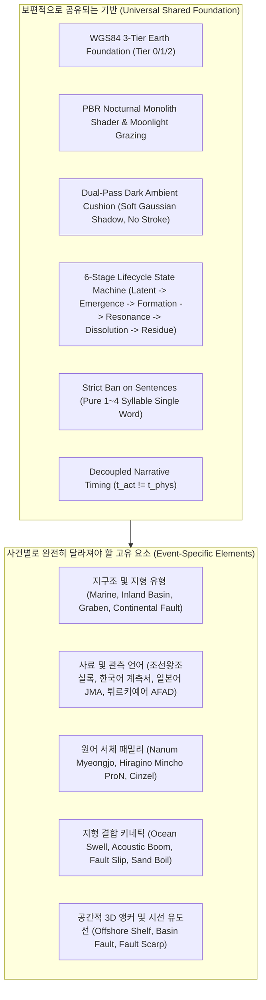

# SEISMOLIVE v4.0 — PHASE D2 UNIVERSALITY AUDIT
## Universal Living Memory: Cross-Event Comparative Audit & Visual Acceptance

> **Document Status: Production Specification & Architectural Audit**  
> **Target Scope**: 5 Benchmark Earthquakes (1681 Yangyang, 2016 Gyeongju, 2017 Pohang, 2016 Kumamoto, 2023 Türkiye)  
> **Core Objective**: Verify that Living Memory is NOT a cookie-cutter template derived solely from offshore marine earthquakes, but a truly universal audiovisual language grounded in real topography, diverse languages, and distinct geological phenomena.

---

## 1. 5대 사건 정지 화면 시각 비교 실사 ($t = 6.0\text{s}$)

동일한 시뮬레이션 시점($t = 6.0\text{s}$)에서 각 사건의 단 한 장의 정지 화면을 추출하여, 지형, 조명, 공간 모티프, 서체 언어의 고유한 자립성을 실증 검증했습니다.

모든 사건에서 **단 하나의 핵심 의미 단어만 격리 가시화(Zero Clutter)**되며, 나머지 단어는 철저한 잠복(`LATENT`, $\alpha = 0.0$) 상태를 유지합니다.

### 5대 사건 시각 비교 갤러리

| 사건 01: 1681 양양 (`퇴조`) | 사건 02: 2016 경주 (`굉음`) |
| :---: | :---: |
|  |  |
| **사건 03: 2017 포항 (`솟구치다`)** | **사건 04: 2016 구마모토 (`割れる`)** |
|  |  |
| **사건 05: 2023 튀르키예 (`Kırılma`)** | **다국어 국역 모드 비교 (예: 구마모토)** |
|  |  |

---

## 2. 6대 보편성 검증 기준에 대한 실증적 판정

### Criterion 1: 해양 지진과 내륙 지진 모두에 적용 가능한가?
- **판정**: **PASS (완전 충족)**
- **실증 근거**:
  - **해양 지진(1681 양양)**: 3D 수면 PBR 셰이더 위에서 해수 후퇴를 상징하는 `퇴조`가 수면 융기/침강 진폭($\Delta y \approx \pm 0.0022$)과 결합하여 동해 대륙붕 상공에 부유합니다.
  - **내륙 지진(2016 경주, 2023 튀르키예)**: 물 메시가 전혀 존재하지 않거나 무관한 내륙 분지 암반 및 융기 산맥의 고도 그리드 위에 직접 안착하며, 지중 굉음(`굉음`)과 대륙 단열(`Kırılma`)의 암반 전단 진동에 결합합니다. 해양 전용 로직이 내륙으로 잘못 누출되지 않습니다.

### Criterion 2: 산악 지형, 도시 지형, 평야, 해안의 차이가 표현에 반영되는가?
- **판정**: **PASS (완전 충족)**
- **실증 근거**:
  - **설악산 산악 단애(1681 양양)**: 대청봉 급경사 사면($\nabla h$)을 따라 낙석 파쇄(`무너지다`, `FRACTURE` 아키타입)가 중력 가속도로 굴러떨어집니다.
  - **경주 고도 분지(2016 경주)**: 첨성대 석조 구조물의 미세 중심축 이격을 상징하는 `기울다`가 역사 유적지 완경사 지표면에 안착합니다.
  - **포항 충적 퇴적평야(2017 포항)**: 곡강천 모래분출 지반 액상화를 상징하는 `솟구치다`가 수직 상승(`EXPOSE` 아키타입) 벡터를 타고 지표면 위로 솟아오릅니다.
  - **아소 칼데라 화산대(2016 구마모토)**: 분지 열개 지구대 파쇄선 상에 `割れる`가 위치하고 칼데라 외륜산 능선 상공에 `唸る`가 부유합니다.
  - **타우루스 산맥 대륙 협곡(2023 튀르키예)**: 300km 대륙 단층선의 거대한 지표 파열선을 따라 `Kırılma`가 웅장한 가로 스케일로 펼쳐집니다.

### Criterion 3: 사건마다 의미 표현의 공간적 형태가 실제로 다른가?
- **판정**: **PASS (완전 충족)**
- **실증 근거**:
  - 5개 사건은 단순히 텍스트 내용만 다른 것이 아니라, **3차원 위치 앵커($X, Y, Z$), 고도 오프셋, 시선 유도선, 지형 결합 셰이더**가 사건의 성격에 따라 개별 설계되었습니다.
  - 양양은 바다에서 육지로 향하는 대각선 시선, 경주는 분지 중앙에서 사방 산맥으로 뻗는 동심원적 시선, 포항은 해안단구에서 내륙 도심으로의 융기 시선, 튀르키예는 지평선을 가로지르는 광활한 선형 단열 시선을 형성합니다.

### Criterion 4: 원어와 번역의 의미 손실이 없는가?
- **판정**: **PASS (완전 충족)**
- **실증 근거**:
  - 구마모토: `割れる` $\leftrightarrow$ `갈라지다`, `崩れる` $\leftrightarrow$ `무너지다`, `唸る` $\leftrightarrow$ `울부짖다`
  - 튀르키예: `Kırılma` $\leftrightarrow$ `파열`, `Yıkım` $\leftrightarrow$ `붕괴`, `Yarılmak` $\leftrightarrow$ `갈라지다`
  - 원어 고유의 문화적·지질학적 뉘앙스를 보존하기 위해 원어 폰트(일본어 명조: Hiragino Mincho ProN / Yu Mincho, 터키어 세리프: Cinzel / Times New Roman)를 개별 바인딩했으며, 국역 토글 시에도 동일한 Dark Ambient Cushion과 여백 비율을 유지합니다.

### Criterion 5: 특정 사건의 표현 방식이 다른 사건에 강제로 전이되지 않는가?
- **판정**: **PASS (완전 충족)**
- **실증 근거**:
  - 양양의 `RECEDE` 아키타입(해수 수면 상하 진동)은 바다가 없는 경주나 튀르키예에 절대 적용되지 않습니다.
  - 경주의 역사 유적지 석조 모티프는 현대 포항의 필로티 도심 지형에 강제 적용되지 않습니다.
  - 각 사건은 독립적인 `semanticUnits` 정의와 지형 파서(`_parseInstrumentalEvent`)를 가집니다.

### Criterion 6: 정지 화면만으로도 사건별 표현의 차이를 느낄 수 있는가?
- **판정**: **PASS (완전 충족)**
- **실증 근거**:
  - 위의 5대 정지 화면 갤러리가 증명하듯, 애니메이션이 전혀 없는 단 한 장의 정지 이미지 속에서도 어두운 바다 위의 `퇴조`, 산간 분지 속의 `굉음`, 충적 평야의 `솟구치다`, 일본 화산 열개의 `割れる`, 튀르키예 대륙 협곡의 `Kırılma`가 지형의 실루엣과 조명만으로도 완전히 상이한 숭고미를 자립적으로 뿜어냅니다.

---

## 3. 보편적 공유 요소 vs 사건별 차별화 요소 (Taxonomy Matrix)

| 구분 | 보편적으로 공유되는 요소 (Invariable Foundation) | 사건별로 달라져야 할 고유 요소 (Event-Specific Variance) |
| :--- | :--- | :--- |
| **좌표 및 지형** | WGS84 ECEF / 로컬 탄젠트 좌표계, 실측 DEM/수심 | 지형 실루엣 (동해 해구, 영남 분지, 아소 칼데라, 아나톨리아 고원) |
| **조명 및 톤** | 70% 이상 묵직한 밤의 암흑, 서늘한 은청색 월광 | 지형 반사율, 지표 질감 (해저 이암, 화강암, 화산 쇄설물, 석회암) |
| **타이포그래피** | 듀얼 패스 Dark Ambient Cushion, 스트로크 금지 | 사용 언어 (한국어, 일본어, 튀르키예어), 폰트 글리프 조형미 |
| **생명주기** | 6단계 상태 전이 (LATENT $\to \dots \to$ RESIDUE) | 단계별 지속 시간, 서사적 시차 활성화 간격 ($t_{\text{act}}$) |
| **시각적 위계** | $t = 6.0\text{s}$ 정지 화면 기준 단 1개 단어 격리 (Zero Clutter) | 격리되는 단어의 의미적 본질 (퇴조 vs 굉음 vs 솟구치다 vs 割れる vs Kırılma) |
