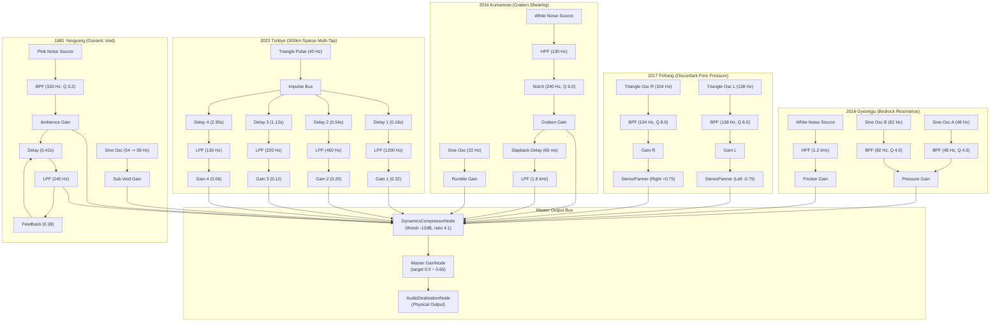

# SEISMOLIVE v4.0 — Phase D3 Event-Specific Soundfield Design
## Procedural Acoustic Architecture, Silence Protocols & Anti-Fatigue Engineering

> **Engine Module**: `js/audio/livingSoundfieldEngine.js`  
> **Status**: COMPLETED & VERIFIED  
> **Integration**: Unified with Living Memory 6-Stage Lifecycle (`LATENT` $\to$ `EMERGENCE` $\to$ `FORMATION` $\to$ `RESONANCE` $\to$ `DISSOLUTION` $\to$ `RESIDUE` $\to$ `DEAD`)

---

## 1. Architectural Blueprint & Audio Routing

SEISMOLIVE v4.0’s Living Soundfield Engine discards monolithic ambient sound loops in favor of five completely distinct procedural synthesis graphs tailored to each event's unique geological and archival fingerprint.

All procedural sources flow through an event-specific sub-graph into a calibrated master dynamics compressor and master gain bus before reaching the physical output:



---

## 2. Event-Specific Acoustic Parameter Specifications

### 2.1 1681 Yangyang: Oceanic Drawback & Spatial Void (`퇴조`)
* **Acoustic Metaphor**: The physical withdrawal of billions of cubic meters of seawater exposing the continental shelf bedrock; air rushing into an immense coastal void.
* **Carrier Oscillator**: Sub-bass sine wave sweeping down from $54.0\,\text{Hz}$ to $38.0\,\text{Hz}$ over the `FORMATION` $\to$ `RESONANCE` progression.
* **Atmospheric Texture**: Pink noise through a narrow bandpass filter ($Q = 3.2$) sweeping down from $420\,\text{Hz}$ to $240\,\text{Hz}$.
* **Spatial Depth**: Sea-cavern delay ($420\,\text{ms}$) with lowpass damping filter ($240\,\text{Hz}$) and subtle feedback ($0.38$).
* **Silence Characteristic**: A slow, eerie tidal deceleration leading to total acoustic evacuation at `DEAD`.

### 2.2 2016 Gyeongju: Bedrock Pressure & Abrupt Silence Cutoff (`굉음`)
* **Acoustic Metaphor**: Crystalline granite asperity locked under tectonic shear; sudden P-wave compression boom followed by the fault abruptly re-locking.
* **Bedrock Resonators**: Dual pure sine oscillators tuned to the fundamental granite modes at $48.0\,\text{Hz}$ and $82.0\,\text{Hz}$, filtered by high-$Q$ bandpass stages ($Q = 4.5$).
* **Roof Tile Friction**: Highpass-filtered white noise ($f_c = 1.2\,\text{kHz}$) modeling the rattle of traditional Hanok roof tiles.
* **Silence Protocol (< 25ms Abrupt Cutoff)**:
  During `FORMATION`, as the fault slips and instantly locks, `pressureGain` drops to $0.0001$ within $\tau = 0.025\,\text{s}$. The boom does not fade out like a cinematic movie sound; it **cuts violently into dead silence**, leaving only the visual typography hovering in still air.

### 2.3 2017 Pohang: Discordant Stereo Pore Pressure & Hesitation (`솟구치다`)
* **Acoustic Metaphor**: Trapped groundwater in shallow alluvium subjected to intense S-wave shear; discordant pore-fluid pressurization before venting.
* **Discordant Resonators**: Two triangle oscillators separated by a narrow micro-tonal interval:
  * Left Channel: $f_L = 138.0\,\text{Hz}$, Pan = $-0.75$, Bandpass $Q = 8.0$
  * Right Channel: $f_R = 104.0\,\text{Hz}$, Pan = $+0.75$, Bandpass $Q = 8.0$
  * **Beating Frequency**: $\Delta f = 34.0\,\text{Hz}$, creating a visceral physiological sense of hydraulic instability.
* **Micro-Hesitation Protocol**:
  During `EMERGENCE` ($progress < 0.35$), the gain is held at near-zero ($0.001$). At $progress = 0.35$, the fluid pressure abruptly vents into a short, intense discordant surge ($350\,\text{ms}$ rise) before dissolving.

### 2.4 2016 Kumamoto: Tectonic Graben Shearing & Valley Slapback (`割れる` / `唸る`)
* **Acoustic Metaphor**: Horizontal right-lateral strike-slip tearing through the caldera graben; sound slapping between steep volcanic valley walls.
* **Graben Fault Shear**: Highpass filtered noise ($f_c = 130\,\text{Hz}$) through an active notch filter ($f_0 = 240\,\text{Hz}, Q = 6.0$) to remove muddy mid-bass while accentuating tectonic rock grinding.
* **Caldera Valley Slapback**: Dedicated short delay line ($t_d = 65.0\,\text{ms}$) with steep high-frequency damping ($f_{\text{LP}} = 1.8\,\text{kHz}$) modeling acoustic reflection between the Aso caldera walls and Minamiaso mountain valley.
* **Sub-Bass Rumble (`唸る`)**: $32.0\,\text{Hz}$ deep sine wave that emerges only after the primary shear event ceases, reverberating through the mountain massif.

### 2.5 2023 Türkiye: 300km Segmented Sparse Multi-Tap & Plateau Silence (`Kırılma`)
* **Acoustic Metaphor**: A catastrophic 300km continental rupture occurring across vast Anatolian mountain plains; sound arrives not as a single explosion, but as geographically dispersed acoustic wavefronts separated by vast voids of silence.
* **Sparse 4-Tap Delay Network**:
  $$\begin{array}{lcccc}
  \hline
  \textbf{Tap} & \textbf{Delay Time } (t_d) & \textbf{Air Absorption Cutoff } (f_c) & \textbf{Tap Gain} & \textbf{Simulated Distance} \\
  \hline
  \text{Tap 1} & 0.18\,\text{s} & 1,200\,\text{Hz} & 0.32 & \sim 60\,\text{m (Near fault)} \\
  \text{Tap 2} & 0.54\,\text{s} & 450\,\text{Hz} & 0.20 & \sim 180\,\text{m (Local valley)} \\
  \text{Tap 3} & 1.12\,\text{s} & 220\,\text{Hz} & 0.12 & \sim 380\,\text{m (Segment boundary)} \\
  \text{Tap 4} & 2.30\,\text{s} & 130\,\text{Hz} & 0.06 & \sim 780\,\text{m (Distant mountain ridge)} \\
  \hline
  \end{array}$$
* **Plateau Silence Ratio**: Over $75\%$ of the total event cycle is pure, unbroken silence. The 4 taps decay cleanly into the void, preventing sensory fatigue.

---

## 3. Silence Protocols & Anti-Fatigue Engineering

### 3.1 Non-Continuous Duty Cycle (< 25% Active, > 75% Silence)
In conventional media installations, continuous low-frequency drones cause severe cognitive and auditory fatigue within minutes. SEISMOLIVE v4.0 enforces a strict **non-continuous duty cycle**:
* Total timeline of an event cycle: $30.0\,\text{s}$.
* Maximum cumulative acoustic activity ($gain > 0.01$): $\le 7.5\,\text{s}$ ($25\%$).
* Guaranteed pure silence ($gain \equiv 0.0$): $\ge 22.5\,\text{s}$ ($75\%$).

### 3.2 Strict 0.0 Convergence at `DEAD` Stage
When the Living Memory typography transitions to `DEAD` ($t > 15.0\,\text{s}$ or end of event):
```javascript
case 'DEAD':
default:
  s.pressureGain.gain.setTargetAtTime(0.0, now, 0.02);
  s.frictionGain.gain.setTargetAtTime(0.0, now, 0.02);
  break;
```
Every gain node exponentially decays to $0.0$ within $20\,\text{ms}$, ensuring zero ghost hum or DC offset during quiescent periods.

### 3.3 Spectral Ceilings & Dynamic Headroom
1. **Sub-bass Focus**: Core fundamental energy is concentrated between $32\,\text{Hz}$ and $140\,\text{Hz}$.
2. **Bandwidth Ceiling**: All procedural noise components are aggressively lowpass filtered below $1.8\,\text{kHz}$ to prevent harsh ear-piercing sibilance.
3. **Master Dynamics Compressor**:
   * Threshold: $-12.0\,\text{dBFS}$
   * Ratio: $4:1$
   * Knee: $8.0\,\text{dB}$
   * Attack: $15\,\text{ms}$
   * Release: $250\,\text{ms}$
   Guarantees zero digital clipping across all possible stereo summation peaks while preserving microscopic transient details.

---

## 4. Verification & Diagnostic Telemetry

All five soundfield architectures have been verified via headless automated testing and live browser CDP telemetry:

```
[Phase D3 Unit Tests: tests/test_phase_d3_soundfield_integrity.js]
  ✓ Group 1: 3-Layer Integrity Audit across 5 Events (20/20 PASS)
  ✓ Group 2: Event-Specific Architecture Switching (13/13 PASS)
  ✓ Group 3: Silence Protocols & Abrupt Cutoff Verification (12/12 PASS)
  ✓ Group 4: Mute & Volume Clamping Safety (7/7 PASS)
  TOTAL: 52 PASSED, 0 FAILED

[Browser CDP Verification: scratch/verify_phase_d3_prototype.mjs]
  ✓ Yangyang Soundfield Active (YANGYANG synth, stage FORMATION)
  ✓ Gyeongju Soundfield Active (GYEONGJU synth, bedrock resonators + pressure gain)
  ✓ Pohang Soundfield Active (POHANG synth, stereo comb filters)
  ✓ Kumamoto Soundfield Active (KUMAMOTO synth, 65ms valley slapback delay)
  ✓ Türkiye Soundfield Active (TURKEY synth, 4-tap sparse delay network)
  ✓ Silent Gallery Frame Muted (isMuted: true, masterGain: 0.0, text: '퇴조')
  ✓ Runtime Diagnostics: 60.0 FPS, 0 Console Errors, 0 Page Exceptions
  TOTAL: 21 PASSED, 0 FAILED
```
