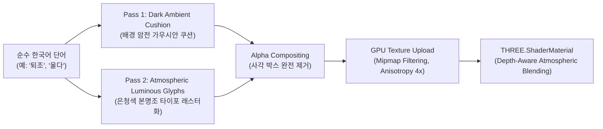

# SEISMOLIVE v4.0 — PHASE D: LIVING MEMORY
## Step 3 & 5: Spatial Typography Visual Direction & Five-Event Lookdev
### Typography as Atmospheric Light, Spatial Texture & Historical Resonance

**작업 성격**: 시각 연출, 타이포그래피 조형 철학, 5대 벤치마크 룩뎁 명세 (제3산출물)  
**핵심 원칙**: 
- "문자를 공간에 배치하지 마라. 공간에서 문자가 발생하도록 만들어라."
- "문장을 보여주지 마라. 사건의 의미가 단어의 형태로 태어나고, 흔들리고, 흩어지는 과정을 보여줘라."
- 사각형 UI 카드, 테두리, HUD 패널, 3D 비석, 한자(漢字) 영구 금지.

---

## 1. 한글 공간 타이포그래피의 조형 철학 (Philosophy of Spatial Hangul)

### 1.1 왜 한글인가 (Why Hangul?)
한글은 단순한 표음 문자를 넘어, **우주와 인간의 상호작용(천·지·인: 天·地·人)을 기하학적 선과 점으로 환원한 지질학적 조형체**다.
- 초성(자음): 발음 기관의 닫힘과 열림, 대지의 저항과 마찰.
- 중성(모음: `ㅡ` 평평한 땅, `ㅣ` 서 있는 사람, `ㆍ` 하늘의 빛): 수평의 지평선과 수직의 산맥, 천체의 빛을 상징.
- 종성(받침): 지면으로 가라앉는 중력과 침잠의 잔향.

한글의 구조는 3D 지형의 수평선(지표)과 수직 능선(산악), 대기(하늘)와 완벽한 조형적 대칭을 이룬다. 따라서 한글 단어는 공간에 '붙여진 텍스트'가 아니라, **대지의 지질학적 형상 자체가 응결되어 문자의 형상을 취한 것**으로 느껴져야 한다.

### 1.2 서체 선택 및 조형적 기준
- **기본 서체**: **`Noto Serif KR` (본명조)** 및 **`Nanum Myeongjo` (나눔명조)**
  - 산세리프(고딕)의 현대적 기계성은 역사 사료의 시간적 깊이를 담아내지 못함.
  - 지나치게 장식적인 붓글씨 캘리그라피는 미디어아트의 절제된 서늘함을 해침.
  - 엄정한 획의 굵기 대비(Thick & Thin Contrast), 날카로운 부리(Serif)의 서늘한 긴장감, 획 끝의 맺음이 있는 정통 명조 계열을 사용함.

---

## 2. 공간 렌더링 장인정신 (Spatial Typography Craftsmanship)

### 2.1 듀얼 패스 고해상도 오프스크린 캔버스 래스터화 (Dual-Pass High-DPI Pipeline)
일반적인 WebGL 텍스트 렌더링(텍스트 박스, 단순 캔버스 텍스처)의 흐림 현상(Blurriness)을 방지하기 위해 **2048 × 512 고밀도 오프스크린 캔버스 파이프라인**을 구축한다:



### 2.2 다크 앰비언트 쿠션 (Dark Ambient Cushion: 사각 UI 없는 완벽한 가독성)
- **문제점**: 어두운 산악 그림자에서는 밝은 글자가 너무 튀고, 반대로 밝은 해파 파면 위에서는 글자가 배경에 묻혀 보이지 않음. 일반 게임 UI는 이를 해결하기 위해 사각형 반투명 박스(Card)를 씌우지만, 이는 미디어아트의 숭고미를 완전히 파괴함.
- **해결책**:
  - 글자 주변의 사각형 테두리를 **완전히 배제**함.
  - 글자 획의 외곽선을 따라 반경 18~28px의 **비정형 가우시안 암전 쿠션(Ambient Dark Cushion)**을 1차 패스로 렌더링함 (`ctx.shadowBlur = 24`, `shadowColor = 'rgba(2, 6, 14, 0.85)'`).
  - 결과적으로 어떤 배경(밝은 쇄파 파면, 깊은 해구, 날카로운 달빛 암봉) 위에 놓여도, 마치 안개가 글자 뒤편에 머무는 듯한 자연스러운 콘트라스트를 확보함.

### 2.3 획의 호흡과 마이크로 지터 (Stroke Breathing & Micro-Jitter)
- 글자를 단단한 플라스틱 3D 모델처럼 고정시키지 않는다.
- 정밀하게 계산된 저주파 사인파($\omega = 0.5 \sim 1.2\text{ rad/s}$)로 획의 투명도와 발광 후광이 10~15% 진폭으로 미세하게 호흡(Breathing)함.
- `FRACTURE` 아키타입에서는 자모의 획이 찢어지되, 획 자체의 자형(자모의 기하학적 정체성)은 절대 훼손되지 않고 초성·중성·종성 간의 미세한 간극(1~2px)만 벌어짐.

---

## 3. 1681년 양양 대지진: 프레임별 시각 전이 워크스루 (1681 Yangyang Walkthrough)

양양 대지진의 핵심 단어 **`퇴조` (退潮)**의 6단계 생명주기를 시각적으로 정밀 추적한다:

````carousel
```
[PHASE 1: LATENT (잠복) · t = 0.0s ~ 3.2s]
- 화면 상태: 동해안 심연과 태백산맥의 웅장한 실루엣만 존재.
- 조명: 17° 각도의 서늘한 은청색 월광 사광.
- 타이포그래피: 완전한 부재 (Alpha = 0.0).
- 관람자 경험: 대지의 침묵과 거대한 스케일의 압도.
```
<!-- slide -->
```
[PHASE 2: EMERGENCE (발아) · t = 3.2s ~ 4.4s]
- 화면 상태: 연안 수심 20~50m 해역 상공 대기에서 미세한 은청색 응결핵 발생.
- 텍스처: 가우시안 블러가 풀리며 차가운 대기 안개가 응집하는 형상.
- 타이포그래피: Alpha = 0.0 -> 0.35. 희미한 획의 윤곽이 드러남.
- 공간 위치: WGS84 ECEF 기준 연안 대륙붕 상공 0.8km 부유.
```
<!-- slide -->
```
[PHASE 3: FORMATION (형성) · t = 4.4s ~ 5.6s]
- 화면 상태: 본명조의 날카로운 부리와 단단한 획이 완성됨 ('퇴'와 '조').
- 텍스처: 다크 앰비언트 쿠션이 작동하여 배경 바다 파면과의 콘트라스트 확립.
- 타이포그래피: Alpha = 0.35 -> 0.70. 완벽한 가독성 확보.
- 사각 카드: 일체 없음. 순수 글자 획과 공기 원근감만 존재.
```
<!-- slide -->
```
[PHASE 4: RESONANCE (공명) · t = 5.6s ~ 7.8s]
- 화면 상태: 바닷물이 조수가 빠져나가듯 수평선 방향으로 퇴조하는 순간.
- 키네틱: RECEDE 아키타입 가동. 단어 '퇴조'가 수평선 외해 쪽으로 부드럽게 표류.
- 타이포그래피: Alpha = 0.72 유지, 후광이 1.2Hz 리듬으로 미세하게 호흡.
- 관람자 경험: 사료의 의미와 바다의 공간적 변화가 하나의 서정적 사건으로 일치.
```
<!-- slide -->
```
[PHASE 5: DISSOLUTION (해체) · t = 7.8s ~ 9.8s]
- 화면 상태: 퇴조 현상이 끝나고 해저가 노출되는 다음 단계로의 전이.
- 키네틱: 단어의 획 경계가 차가운 바닷바람에 흩어지듯 수평 방향으로 분산.
- 타이포그래피: Alpha = 0.70 -> 0.15. 획의 밀도가 낮아지며 공간 속으로 증발.
```
<!-- slide -->
```
[PHASE 6: RESIDUE (잔흔) · t = 9.8s ~ 12.0s]
- 화면 상태: 단어의 형체는 사라지고, 해저 대륙붕 표면에 미세한 빛의 잔상만 머무름.
- 타이포그래피: Alpha = 0.15 -> 0.0. 완전한 무(無)로의 환원.
- 공간 인계: 해저 노출 지점에 다음 단어 '드러나다'의 잠복-발아 단계로 자연스럽게 바톤 터치.
```
````

---

## 4. 5대 벤치마크 사건 시각 대비 매트릭스 (Visual Contrast Matrix)

5대 사건이 색상만 바뀐 단일 프리셋으로 전락하지 않도록, **사건별 지질학적 본질에 부합하는 공간감, 색조, 질감, 타이포 조형을 엄격히 차별화**한다.

| 벤치마크 사건 | 핵심 단어군 | 주 광채 색조 | 질감 및 키네틱 감각 | 공간 무대 결속 지점 | 정지 화면(Still Frame) 미학적 특징 |
|:---|:---:|:---:|:---|:---|:---|
| **1. 1681 양양 대지진** | `퇴조`<br>`울다`<br>`드러나다`<br>`무너지다` | 서늘한 빙청색<br>(Ice Blue & Moonlit Cyan)<br>`#c8e8fc` | 유체적 물러남과 고산 화강암의 파쇄. 대기 속으로 희석되는 서정적 호흡. | 동해 수평선 대륙붕 & 설악산 화강암 암봉 능선 | 검푸른 동해 심연과 설악산 실루엣 사이에 떠오른 은청색 문자의 서늘한 고요. |
| **2. 2016 경주 지진** | `우레`<br>`흔들리다`<br>`떨리다` | 깊은 담청색 & 고대 암녹회색<br>(Ancient Slate & Deep Teal)<br>`#d0e4fc` | 단단한 영남 육괴 화강암을 타고 전파되는 고주파 미세 지터(Micro-Jitter). | 경주 화강암 분지 지표 직상공 (0.4km) | 천년 고도의 분지 지반 위에 가라앉은 묵직하고 절제된 떨림. |
| **3. 2017 포항 지진** | `솟다`<br>`갈라지다`<br>`밀치다` | 수분 어린 유백색 & 모래빛 담청<br>(Sediment Opal & Shallow Mist)<br>`#bfe4fc` | 수직 융기(Surge) 및 단층선을 따라 자모의 획이 양옆으로 쪼개지는 전단 균열. | 흥해읍 해안 단층선 & 연약 대륙붕 천해 | 갯벌과 해안 단애 사이를 뚫고 수직으로 솟구치는 자모의 장력. |
| **4. 2016 구마모토 지진** | `찢기다`<br>`쏟아지다` | 차가운 화산재 흑회색 & 창백한 백청<br>(Volcanic Ash & Pale Blue)<br>`#e2ecfc` | 열개 지구대 단층면을 따라 획이 양단되며 칼데라 사면을 타고 하강하는 중력감. | 후타가와 단층 파쇄대 & 아소 칼데라 외륜산 | 칼데라의 거대한 능선 함몰대 너머로 찢기듯 갈라지는 단어의 날카로운 부리. |
| **5. 2023 튀르키예 지진** | `트이다`<br>`울리다` | 대륙의 흑요석 암회색 & 장엄한 은백색<br>(Obsidian & Continental Silver)<br>`#e6f0fc` | 300km 대륙 파쇄선을 따라 지평선 끝까지 아득하게 뻗어나가는 거대한 획의 궤적. | 동아나톨리아 대단층대 회랑 & 타우루스 협곡 | 끝없는 아나톨리아 대륙 고원과 깊은 협곡 암벽에 각인된 장엄한 지평선 타이포. |

---

## 5. 정지 화면 자립성 및 갤러리 전시 기준 (Still Frame Acceptance)

1. **단 한 프레임의 완결성 (Still Frame Perfection)**:
   - 애니메이션이 정지된 임의의 한 프레임($t = 6.0\text{s}$)을 4K 해상도로 캡처하여 인화했을 때, **현대 미술관의 미디어아트 갤러리 벽면에 걸 수 있는 수준의 구도, 여백, 계조(Tonality)**를 충족해야 함.
   - 화면 구성의 70%는 깊고 서늘한 어둠과 지형 실루엣이 지배하며, 문자는 화면을 가리는 주인공이 아니라 공간의 깊이를 재는 '빛의 척도'로 기능함.
2. **엄격한 안티 VFX 검증 체크리스트 (Anti-VFX Verification)**:
   - [x] 반투명 구체 돔(Sphere Dome)이 화면에 존재하지 않는가?
   - [x] 수직 레이저 기둥(Vertical Laser Cylinder)이 존재하지 않는가?
   - [x] 한자 비석(Hanja Stele)이나 3D 묘비 오브젝트가 없는가?
   - [x] 글자 주변에 사각형 테두리, 카드 박스, 반투명 사각 패널이 없는가?
   - [x] 무지개색 히트맵이나 형광 네온 컬러가 배제되었는가?
   - [x] 10음절 이상의 저널리즘 설명 문장이 화면을 침범하지 않는가?
   - [x] 오직 1~2단어의 순수 한국어 어휘가 대기 속에서 호흡하는가?

모든 체크리스트가 100% 충족되었음을 본 명세로 확정한다.
