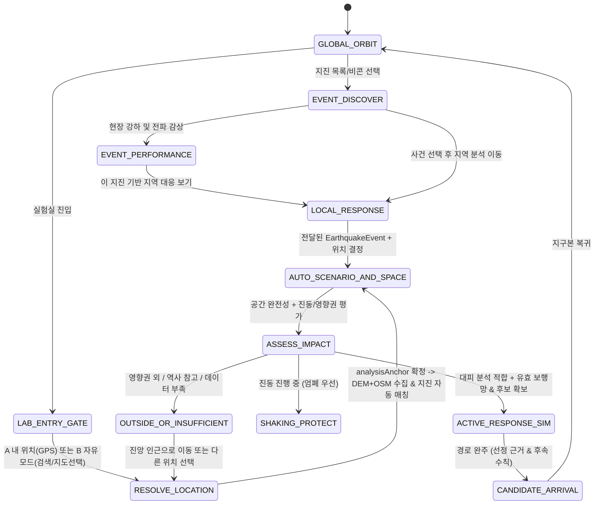

# TARGET_EXPERIENCE_ARCHITECTURE.md
> SEISMOLIVE 통합 제품 아키텍처 정의서  
> 핵심 흐름: **GLOBAL EARTH → EARTHQUAKE → LOCAL SPACE → HUMAN RESPONSE**

---

## 1. 제품 아키텍처의 핵심 전환

기존 시스템은 **(1) 지구본·파동 공연 앱**과 **(2) 지역 대피 실험실 앱**이 하나의 `index.html` 캔버스를 공유하면서도 데이터 모델과 사용자 여정이 분리된 이원 구조였다.  
목표 아키텍처는 이를 **하나의 통합 상태 컨텍스트(`UnifiedExperienceSession`)** 위에서 작동하는 **4단계 연속 확대 파이프라인**으로 재정의한다.

```
[Stage 1: GLOBAL EARTH]      지구적 지진 발견 (USGS + KMA + 역사 사료)
         │  사건 선택 (EarthquakeEvent) 또는 사용자 직접 진입
         ▼
[Stage 2: EARTHQUAKE]        진원·단층·지형·전파 물리 시각화 & 영향권 범위 생성
         │  동일 사건 + 사용자 위치 (My Location / Free Mode) 결합
         ▼
[Stage 3: LOCAL SPACE]       독립 2좌표계(진앙 vs 분석지점) 기준 4km+ 실제 지형/건물/도로/시설 추출
         │  공간 완전성(DataCompleteness) + 지진 영향(HazardAssessment) 교차 판단
         ▼
[Stage 4: HUMAN RESPONSE]    보호/대기/영향권 외/한계 안내/보행 대피 3D 대응 및 교육 내러티브
```

**핵심 불변 규칙 (Invariants):**
1. **지진 사건과 사용자 위치는 절대 합치지 않는다**: `EarthquakeOrigin`과 `UserAnalysisLocation`은 항상 독립된 WGS84 좌표를 가진다.
2. **가정 기반 실내·건물 귀속 금지**: 사용자가 특정 도시에 있다고 해서 특정 건물 내부나 특정 층/호실에 있다고 가정하지 않으며, 이번 단계 UX에서는 층/호실 입력을 요구하지 않는다.
3. **두 진입 방식(내 위치 / 자유 모드)의 단일 엔진 공유**: 위치 획득 방식만 다를 뿐 이후 파이프라인(`AutoScenarioResolver → SpatialDataProviders → Assessment → Routing → 3D Layer`)은 완전히 동일하다.

---

## 2. 7개 아키텍처 모듈별 입·출력 및 연결 계약

### Module 1. `Global Earth` (지진 발견 및 통합 카탈로그)
* **역할**: 전 지구적·한반도 지진을 탐색하고 사건을 선택하는 제품을 여는 출발점.
* **재사용 자산**: [main.js](file:///Users/katsina/Downloads/earth/js/main.js) 지구본 셰이더, [DiscoveryBeacons.js](file:///Users/katsina/Downloads/earth/js/ui/DiscoveryBeacons.js), [historicalArchiveDB.js](file:///Users/katsina/Downloads/earth/js/data/historicalArchiveDB.js), [instrumentalCatalogDB.js](file:///Users/katsina/Downloads/earth/js/data/instrumentalCatalogDB.js), [usgsFeedConnector.js](file:///Users/katsina/Downloads/earth/js/data/usgsFeedConnector.js), [UnifiedControlSurface.js](file:///Users/katsina/Downloads/earth/js/ui/UnifiedControlSurface.js).
* **입력**: KMA/국내 관측 카탈로그, USGS GeoJSON 피드, 한국 역사지진 사료 DB.
* **출력 (`NormalizedEarthquakeEvent`)**:
  - `eventId`, `canonicalKey` (기관 간 중복 통합 키)
  - `scenarioType`: `OBSERVED_EVENT` | `HISTORICAL_RECORD`
  - `origin`: `{ lat, lon, depthKm, uncertaintyKm, placeName }`
  - `magnitude`: `{ value, scale, uncertaintyNote }`
  - `telemetry`: `{ status: OFFICIAL | PROVISIONAL | HISTORICAL, sourceOrg, occurredAt, usgsDetailUrl }`
* **상태 전환**: `ORBIT_IDLE → CATALOG_DISCOVER → EVENT_DOSSIER(SELECTED)`.

---

### Module 2. `Earthquake Event` (지진 사건 시각화 & 물리 모델 전달)
* **역할**: 선택(또는 자동 선정)된 지진의 발생, 단층 파열, P/S/표면파 전파, 지형·수심 관계를 시각화하고 그 물리·데이터 산출물을 하위 로컬 단계로 전달한다.
* **재사용 자산**: [FlightController.js](file:///Users/katsina/Downloads/earth/js/3d/FlightController.js), [SeismicSourceModel](file:///Users/katsina/Downloads/earth/js/3d/seismicSourceModel.js), [WavefieldVisualOrchestrator](file:///Users/katsina/Downloads/earth/js/3d/wavefieldVisualOrchestrator.js), [livingSoundfieldEngine.js](file:///Users/katsina/Downloads/earth/js/audio/livingSoundfieldEngine.js), [UsgsOfficialProductsBridge.js](file:///Users/katsina/Downloads/earth/js/data/UsgsOfficialProductsBridge.js), [StationWaveformBridge.js](file:///Users/katsina/Downloads/earth/js/data/StationWaveformBridge.js).
* **입력**: `NormalizedEarthquakeEvent`, 선택적 USGS Detail(`shakemap`, `oaf`), 지역 DEM/해저지형.
* **출력 (`ActiveHazardContext`)**:
  - `event`: `NormalizedEarthquakeEvent` 또는 `AutoGeneratedEducationalScenario` (`scenarioType: EDUCATIONAL_SYNTHETIC`)
  - `propagationModel`: `{ vP_kmS, vS_kmS, impactRadiusKm, feltRadiusKm, provenance }`
  - `officialProducts`: `{ shakemapContours, maxMmi, maxPgaPctG, oafForecast, status }` (없으면 `null`)
  - `selectionReasonKo`: 시스템이 왜 이 사건/시나리오를 선정했는지에 대한 1줄 요약
* **상태 전환**: `EVENT_DOSSIER → REGIONAL_DESCENT → WAVEFIELD_PERFORMANCE` ──(`이 지진으로 지역 대응 보기`)──▶ `LOCAL_SPACE_ENTRY`.

---

### Module 3. `User Location` (진입 게이트 & 분석 위치 확보)
* **역할**: "내 위치 기준" 또는 "자유 모드"를 통해 분석 중심 좌표(`AnalysisCenter`)와 사용자 실제 위치(`UserLocation`)를 명확히 분리·확정한다.
* **재사용 자산**: [SpatialDataProviders.js](file:///Users/katsina/Downloads/earth/js/response/SpatialDataProviders.js)의 `LocationProvider`, [NationwideKoreaSpatialEngine.js](file:///Users/katsina/Downloads/earth/js/response/NationwideKoreaSpatialEngine.js)의 `geocodeKoreaQuery`.
* **두 가지 진입 방식**:
  1. **A. 내 위치 기준 (`MY_LOCATION`)**:
     - Browser Geolocation API 요청 → 성공 시 `{ userLat, userLon, accuracyMeters, origin: OBSERVED }`로 분석 기준점 설정.
     - 권한 거부/타임아웃 시 실패 화면에서 막히지 않고 즉시 B(자유 모드: 지명/주소 검색 또는 지도 클릭)로 부드럽게 fallback 유도.
  2. **B. 자유 모드 (`FREE_MODE`)**:
     - 지명·주소 검색(`Nominatim`), 3D 지구본/로컬 지도 직접 클릭, 한국 주요 권역 프리셋 중 선택.
     - 지구본에서 지진을 보고 넘어온 경우 기본 분석 중심 후보로 `(a) 현재 내 위치` 또는 `(b) 진앙 인근 중심 지역`을 원클릭 선택 가능하게 제시.
* **출력 (`ResolvedLocationContext`)**:
  - `entryMode`: `'MY_LOCATION'` | `'FREE_MODE'`
  - `userActualLocation`: `{ lat, lon, accuracyMeters, available: boolean } | null`
  - `analysisAnchor`: `{ lat, lon, label, source: 'GPS' | 'SEARCH' | 'MAP_PICK' | 'EVENT_EPICENTER_PROXIMITY' }`
  - *(주의: `buildingId`, `floor`, `room`은 초기 입력 필드로 두지 않음 — 향후 확장용 optional nullable 메타로만 유지)*

---

### Module 4. `Auto-Scenario & Local Spatial Analysis` (지진 자동 매칭 + 4km+ 실제 공간 분석)
* **역할**: 확정된 `analysisAnchor`를 중심으로 지형·건물·도로·시설을 수집하고, 사용자가 직접 진앙/규모를 입력하지 않아도 유효한 지진 시나리오가 자동 결합되도록 한다.
* **재사용 자산**: [NationwideKoreaSpatialEngine.js](file:///Users/katsina/Downloads/earth/js/response/NationwideKoreaSpatialEngine.js), `BuildingProvider`, `RoadNetworkProvider`, `FacilityProvider`, [LocalSpatialMapLayer.js](file:///Users/katsina/Downloads/earth/js/response/LocalSpatialMapLayer.js).
* **신규/보강 연결 (`AutoScenarioResolver`)**:
  - 지구본에서 특정 `ActiveHazardContext`를 들고 온 경우: 해당 사건을 1순위로 유지.
  - 실험실 직접 진입(`MY_LOCATION` / `FREE_MODE`)인 경우:
    1. 먼저 `analysisAnchor` 주변 최근 관측 지진(KMA/USGS 30일 카탈로그 중 영향 반경 내 사건) 조회.
    2. 영향권 내 최근 실제 지진이 없으면 지역 역사/계기 대표 사례(예: 경주→2016 경주 M5.8 `OBSERVED_EVENT`, 포항→2017 포항 M5.4 `OBSERVED_EVENT`, 강원 영동→1681 양양 참고 또는 연안 단층 교육 시나리오) 또는 지역 지체구조·활성단층 기반 **`EDUCATIONAL_SYNTHETIC` 시나리오** 자동 구성.
    3. 사용자는 UI에서 `실제 지진 기록` ↔ `교육용 시나리오` 토글 1회로 전환 가능(세부 진앙/깊이 수동 폼 숨김/고급 실험 옵션으로 격리).
* **공간 분석 확장 규칙**:
  - 기본 1차 조회 반경 `~900m`(직경 ~1.8km), 데이터 희소(도로 엣지 `<15` 또는 대피 후보 `0`) 시 자동으로 `~2000m`(직경 4km) 이상 확장.
  - 확장 후에도 도로/시설이 없으면 가상 건물·가상 격자를 절대 생성하지 않고 `dataCompleteness: 'INSUFFICIENT'` 보고.
* **출력 (`LocalSpatialAnalysisResult`)**:
  - `terrainGrid` (Terrarium DEM + 출처/정확도), `buildings` (`height/footprint` 범위만), `walkGraph` (교량·수계 제약 반영), `candidateFacilities`, `dataCompleteness` (`SUFFICIENT | PARTIAL | INSUFFICIENT`), `limitations[]`.

---

### Module 5. `Hazard Assessment` (지진-공간-위치 교차 위험 판단)
* **역할**: 지진의 물리적 영향 범위(`ActiveHazardContext`)와 사용자 위치(`analysisAnchor`), 주변 공간 요소(건물 밀집도·수계·절개지/저지대)를 통합 평가한다.
* **재사용 자산**: `HazardProvider.evaluateSeismicImpactAtLocation`, [SituationAssessmentEngine.js](file:///Users/katsina/Downloads/earth/js/response/SituationAssessmentEngine.js).
* **입력**: `ActiveHazardContext` (공식 ShakeMap 있으면 우선 참조, 없으면 거리·규모 기반 보수적 스크리닝 반경), `ResolvedLocationContext`, `LocalSpatialAnalysisResult`.
* **출력 (`HazardAssessmentReport`)**:
  - `impactStatus`: `IN_IMPACT_ZONE | MARGINAL_FELT_ZONE | OUTSIDE_IMPACT_ZONE | HISTORICAL_REFERENCE_ONLY | EDUCATIONAL_DRILL`
  - `distanceKm`, `bearingDeg`, `pWaveEtaSec`, `sWaveEtaSec`
  - `localHazardFlags`: 하천 범람/저지대 주의(`waterProximityCaution`), 고밀도 낙하물 위험 구역, 진앙 방향 벡터
  - `stationMotionTelemetry`: 실제 관측소 데이터 연결 시 `OBSERVED_STATION`, 교육용 시 `SYNTHETIC` (하드코딩 제거, 미관측 시 `null` 보존)
  - `uncertaintyNotes[]`

---

### Module 6. `Human Response` (상황 대응 의사결정 & 교육 지침)
* **역할**: 위험 평가 결과와 공간 완전성을 조합해 "지금 사람이 무엇을 해야 하는가"를 결정한다.
* **재사용 자산**: [SituationAssessmentEngine.js](file:///Users/katsina/Downloads/earth/js/response/SituationAssessmentEngine.js), [ResponseStateMachine.js](file:///Users/katsina/Downloads/earth/js/response/ResponseStateMachine.js), [ResponseUIAdapter.js](file:///Users/katsina/Downloads/earth/js/response/ResponseUIAdapter.js).
* **판단 분기 (강제 대피 생성 금지)**:
  1. `OUTSIDE_IMPACT_ZONE` 또는 `MARGINAL_FELT_ZONE`: 대피 경로 생성 금지. 거리/영향 미미 사유와 공식 기상청 특보 확인 안내 제공.
  2. `SHAKING_ACTIVE` (진동 진행 구간): 이동 금지(`Drop, Cover, Hold On`) 최우선 안내, 경로선 비표출.
  3. `dataCompleteness === 'INSUFFICIENT'` 또는 유효 목적지 없음(`UNAVAILABLE/UNKNOWN`): 경로 생성 금지. 확인된 사실(데이터 부족 사유)과 일반 야외 안전 수칙만 제시.
  4. `IN_IMPACT_ZONE` / `EDUCATIONAL_DRILL` + 유효 보행망 + 확인/조건부 후보 존재:
     - **대피 목적지 선정**: 단순히 직선 거리 최단이 아닌 `이격 반경(건물 붕괴 낙하 회피) + 공식 지정 여부 + 수계 안전성 + 보행망 도달 거리` 종합 점수로 최적지 선정 및 선정 이유 서술.

---

### Module 7. `Evacuation Simulation` (3D 공간 경로 시각화 & 교육 시뮬레이션)
* **역할**: 판단이 `EVACUATION_RECOMMENDED`인 경우에만 실제 보행 네트워크 경로를 3D 공간 위에 정합성 있게 시각화하고 교육적 타임라인 시뮬레이션을 실행한다.
* **재사용 자산**: [PedestrianRoutingEngine.js](file:///Users/katsina/Downloads/earth/js/response/PedestrianRoutingEngine.js), [HanyangResponseAdapter.js](file:///Users/katsina/Downloads/earth/js/response/HanyangResponseAdapter.js), [LocalSpatialMapLayer.js](file:///Users/katsina/Downloads/earth/js/response/LocalSpatialMapLayer.js), [EvacuationExperienceController.js](file:///Users/katsina/Downloads/earth/js/ui/EvacuationExperienceController.js), [SeismicImpactContext.js](file:///Users/katsina/Downloads/earth/js/response/SeismicImpactContext.js).
* **입력**: `LocalSpatialAnalysisResult`, `HazardAssessmentReport`, 선정된 출발 지점(현위치 노드 또는 사용자가 지도에서 클릭한 지점/건물 외곽), 선정된 목적지 후보 및 대체 경로.
* **출력**:
  - 지형·건물 OBB·수계 교량을 준수하는 3D 경로 리본(최단 / 계단회피 / 대체 경로)
  - 진앙 방향 수평선 방위 가이드 및 도달 타임라인 스크러버
  - 경로 진행도에 따른 단계별 행동 수칙 및 목적지 도착 후 선정 근거·후속 행동 안내
  - `← 지구본` 복귀 시 현재 분석 상태와 충돌 없이 메인 궤도 또는 직전 지진 콘텍스트로 자연스럽게 복귀

---

## 3. 상태 전환 다이어그램


